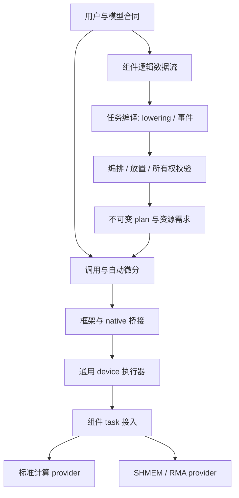

# HyperMulticore 架构与代码归属规范

本规范适用于整个仓库、所有 megakernel、所有设备架构及框架接入。
新代码必须遵守；存量代码按受影响路径逐项整改，不能把既有耦合当作继续扩散的理由。
本文定义职责与依赖方向；具体组件的算法、ABI 和用法另见组件文档。

## 1. 基本约束

- 每个目录有明确的职责，每个文件有主要所有者。按职责命名，不能只用精度、硬件代号或实验代号代替用途。
- 一个数值合同、一份配置解析、一份物理 ABI、一份完成协议应各有唯一解释入口。
- 共享代码按真实的共同语义提取。不能为少几个文件强行合并不同数学、激活保存或梯度实现。
- 通用框架不解释任何具体 megakernel 的专家、概率、模型阶段或张量端口。
- 组件可以使用通用机制；通用机制只能通过显式合同接收组件提供的信息，不能反向导入组件。
- 调优不能改变数值合同、完整工作量、输出覆盖、数据可见性和资源生命周期。
- 优先拼接锁源标准算子的实现，不复制数学源码闭包，不把标准独立算子完整外层塞入每个 task。
- 不构建尚未实现的策略、后端或插件体系；不以未来兼容为由保留第二套配置与执行主线。

## 2. 职责分层

分层依据是语义和产物，不是 Python/C++ 语言、类名或函数调用深度。
同一目录可实现相邻职责，但一个文件不应混合多个独立所有者的策略。

| 职责 | 拥有的内容 | 不拥有的内容 |
| --- | --- | --- |
| 用户与模型合同 | 公共接口、模型持有权重、数值选项、调优请求、能力校验 | 内部物理端口、底层队列和隐式数值替换 |
| 调用与自动微分 | 本轮输入准备、路由、绑定当前物理存储、资源 lease、launch、保存/恢复与梯度 | 重写数学 tiling、修改共享静态 plan |
| 组件逻辑数据流 | tensor、读写效果、实际依赖、组件阶段及数值关系 | 物理 QP、通用 runtime 私有字段 |
| 任务编译 | lowering、分块、事件、任务排序、固定核放置、校验、序列化 | 用户模型语义的静默变更 |
| 框架/native 桥接 | binding、op-api、参数校验、外层 launch 及 workspace | 第二套图构造、业务 device 数学 |
| 通用 device 执行器 | 队列、有限 ready 选择、事件、task 分发及诊断调用 | 专家、概率、clamp、算子私有 tiling 解码 |
| 组件 task 接入 | typed descriptor、业务地址、逻辑核、局部资源与完成适配 | 全局任务规划、重复实现传输机制 |
| 原语 provider | 标准计算及其合法 tiling/资源合同；通用 RMA 与可见性 | 模型阶段顺序、专家布局或概率 plane |

`plan` 是编译结果，不是额外的业务层。计算 provider 与传输 provider 是并列支路，
不是计算依次调用通信的强制串行链。

## 3. 目录与文件归属

下表是目标归属规则，不表示存量文件已经全部符合规范。
需要保留的例外必须说明具体原因、影响范围和退出条件。

| 路径 | 主要职责 |
| --- | --- |
| `hyper_multicore/__init__.py` 与公共选项 | 小型稳定公共入口；不做初始化、编译或设备探测副作用 |
| `modules/<component>/` | 组件接口、调用、数值语义、逻辑图、组件编排及资源需求 |
| `modules/<component>/backends/` | 真实不同的数学/精度执行与保存合同；公共生命周期不能再复制 |
| `scheduler/` | 组件无关的图、任务、事件、队列表示、校验与序列化 |
| `tasks/` | 每种算子的 typed task 参数与 lowering，数学 tiling 的调用适配 |
| `torch/` 等框架目录 | 框架 binding、注册、资源/stream 对接；不存放组件 device 算法 |
| `ops/runtime/` | 通用 device 执行、事件与可观测性；只消费显式的通用合同 |
| `ops/common/<component>/` | 同一组件多个 native 入口共享的业务合同；host 代码明确放在 op_host，device adapter 按架构归属 |
| `ops/common/` 中的算子合同 | 真正可跨组件复用的算子参数编码与通用 primitive |
| `ops/hyper_*/op_host/` | native ABI、形状/类型校验、外层资源与 launch tiling |
| `ops/hyper_*/op_kernel/` | megakernel 入口、task 分发与标准算子 adapter |
| `ops/patches/` | 隔离标准源码所需的最小补丁，按实际算子与目的命名 |
| `shmem/` | 单边通信能力、引擎、QP、内存可见性、通用搬运和通信生命周期 |
| `_build/` | 锁源、依赖准备、隔离拼接、编译、架构选择、打包及制品身份 |
| `diagnostics/` | 通用观测接口与数据处理；组件解释由组件提供 |
| `tests/`、`docs/`、`examples/` | 对应合同的验证、说明和使用方式；不作为生产依赖 |

文件头或模块 docstring 应说明主要职责。公共机制新增组件名称、业务端口、
专家数公式或针对某模型的分支时，必须先判断它是否放错层。

## 4. 必须拆开的合同

### 数值、lowering、编排与执行

- 数值选项决定 dtype、舍入、clamp、概率加权位置、梯度累加等语义。
- lowering 决定逻辑工作怎样变成 task，包括 compact/batched 分组和对应事件计数。
- 编排决定合法依赖内的顺序和核放置，不修改计算量或算子数值。
- 执行配置决定 ready 扫描、依赖刷新与等待；不能借用通信 engine 字段。
- 数学 tiling 由算子/provider 所有。op-host 外层 launch tiling 与 task 内数学 tiling应分别说明。
- 配置只解析一次；有效值可以导出。默认、显式设置和环境变量的优先级不得散落。
- 不同架构可有不同有效默认；统一机制不等于强制统一数值或核数。

### 资源、计划与本轮绑定

- plan 缓存的是可复用的编译结构，不能缓存本轮会失效的物理指针。
- key 必须覆盖实际影响数学、布局、架构能力、lowering 和编排的配置。
- 路由数据、激活、当前权重/scale root、stream 与 ctx 是本轮执行状态。
- 资源需求由组件声明；分配、租用、重绑与释放由明确的资源所有者管理。
- 旧 ctx、重算、并发 stream、FSDP 参数重建和共享 workspace 不得被缓存命中假设覆盖。
- 索引、元素数、行数、字节数和分组单位必须明确；保留真实需要的 64 位地址/偏移。

### 队列与通信

- runtime 只维护一套版本化 header/队列合同；同一就绪机制不保留两个独立控制开关。
- 核参与、任务放置、ready 窗口和等待方式分别表达；窗口不是队列总容量。
- 通信 owner 是协议约束，不是 AIV 奇偶的硬件属性；每个物理队列的 post/quiet 必须符合所有权。
- 通信 provider 不认识专家、路由和概率；组件适配层负责把业务地址转为通用请求。
- 提交返回不等于完成；消费者信用必须覆盖所有 payload 的可消费条件。
- 混用搬运引擎时分别证明完成；源 buffer、接收 buffer、workspace 复用都要有闭环。
- 空 task、冷分组、尾块与终止也属于完成合同，不得因没有 payload 省掉必要信用。

### 标准源码、patch 与 adapter

- 标准源码固定准确 revision；只在隔离构建树应用 patch，不修改系统 CANN 或原始依赖仓。
- patch 用于最小入口、逻辑核和资源生命周期适配；不得把数学算法重写伪装成 adapter。
- adapter 负责 typed descriptor、合法 tiling 参数、逻辑核、局部初始化与收尾。
- 来自标准源码不证明与 native 实际分支、模板、核数和性能相同，未知部分须标明。
- 临时自实现数学必须明确数值合同、标准能力缺口、验证证据和替换条件。
- 既有组件概率乘法/归约、标准算子暂缺的激活 fusion 是有限例外，不能扩散到通用 runtime。

## 5. 指导新代码与存量重构

每个变更先回答以下问题，再决定放置位置：

1. 改的是模型语义、任务表示、编排、执行机制、原语还是资源生命周期？主要所有者是谁？
2. 哪些输入/产物跨层传递？是否新增了同一信息的第二种解释？
3. 新机制是否依赖组件名称、专家编号或物理端口？如果是，应留在组件侧。
4. 不同精度/架构共享的是合同还是恰好相似的代码？保留差异是否更清楚？
5. 变更是否改变默认值、有效核集合、等待时序、事件阈值、数值或 ABI？逐项列出。
6. 正向、无梯度、重算、反向、空/尾数据、旧 ctx、stream 和参数重绑有哪些受影响？
7. 哪些既有门禁仍有效，哪些需要针对性验证？性能控制是否同配、无打点且保留波动？

重构按合同拆分提交：先明确所有者与接口，再迁移实现，最后清理旧入口。
不要同时改变源码版本、数学、传输、调度和计时条件来掩盖归因。
不为整体目录整齐搬动不受影响的实现；不留下永久的双主线兼容层。

## 6. Review 与验收

- 新文件的目录、文件名与主要职责一致；没有实验名、中间迁移名或无意义的 `extra` 语义。
- 公共层无新增组件依赖；组件特化集中在组件/provider。
- 数值、lowering、编排、tiling、传输、生命周期与诊断的边界均能指出唯一所有者。
- Python/C++ ABI 的宽度、offset、单位、flags、版本与 reader/serializer 一致。
- normal/profile/dump 使用同一执行与完成路径，观察不能改变业务逻辑。
- 设备对象按正确架构构建，依赖、patch 与制品身份可复现；不提交 build 或临时诊断制品。
- 受影响的正确性、生命周期与性能门禁通过；无设备证据的架构不能宣称性能无回退。
- 每个例外有具体原因、所有者、验证和退出条件；不能仅写“后续优化”。

架构图用于理解，正文合同用于判定。README 只作为入口，本规范是新开发和存量重构的共同依据。

## 7. MegaMoE native operator ownership

The public `MegaMoeExperts` interface selects precision. Native BF16 and MXFP8
operator identities remain distinct; neither operator family owns the other.
Each native operator directory owns its registration, launch tiling binding,
op-api entry and kernel entry. Shared MoE mechanisms belong to
`ops/common/mega_moe`, with host-only helpers under `op_host` and architecture
adapters under `adapters/arch35`. Shared headers must not register operators.

The shared MX task worker dispatches both forward and backward task graphs;
it is component execution code rather than a standard-math adapter. It consumes
component-owned descriptors. BF16 and MX math adapters call locked standard
sources. Shared transport translates expert descriptors into SHMEM requests;
QP and hardware completion remain in `shmem`. The generic runtime does not own
these mathematical or routing implementations.

Source assembly may copy shared headers into generated closures. Such copies
are build products, not independent source owners. Changes must update the
single checked-in owner, its consumers and source-assembly checks together.
