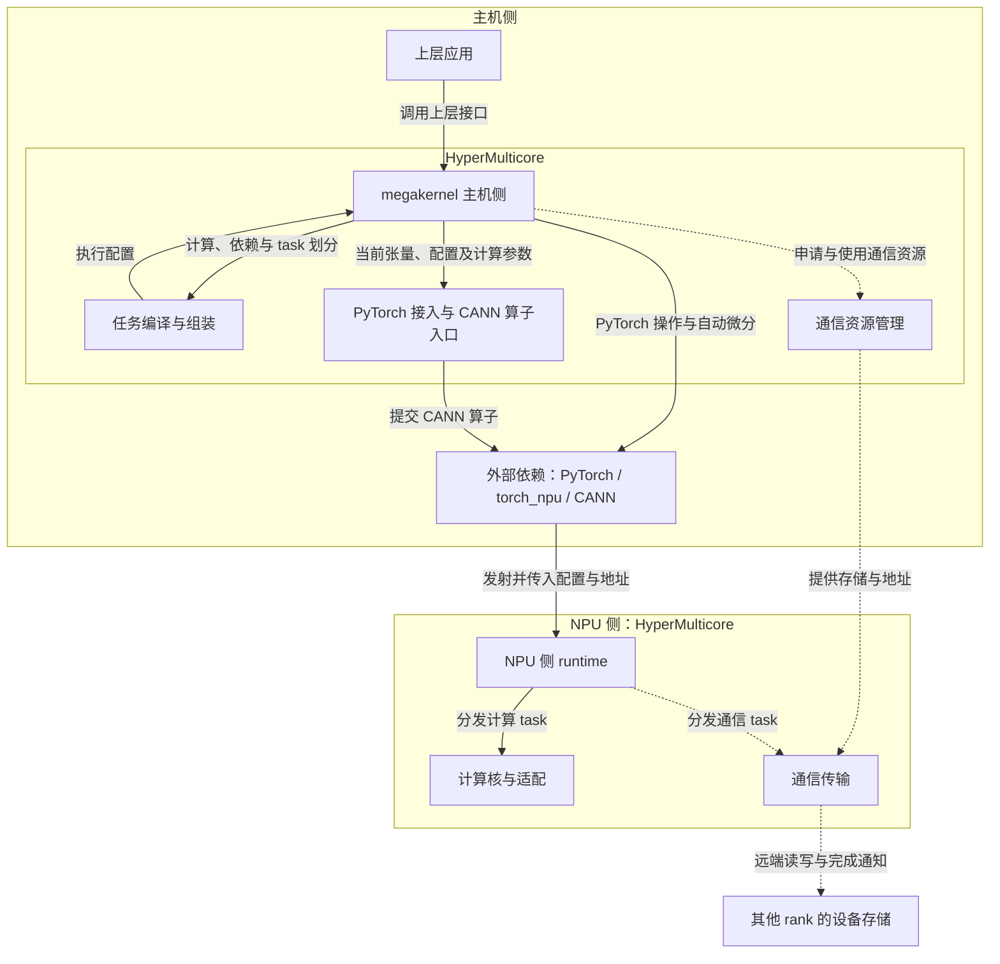
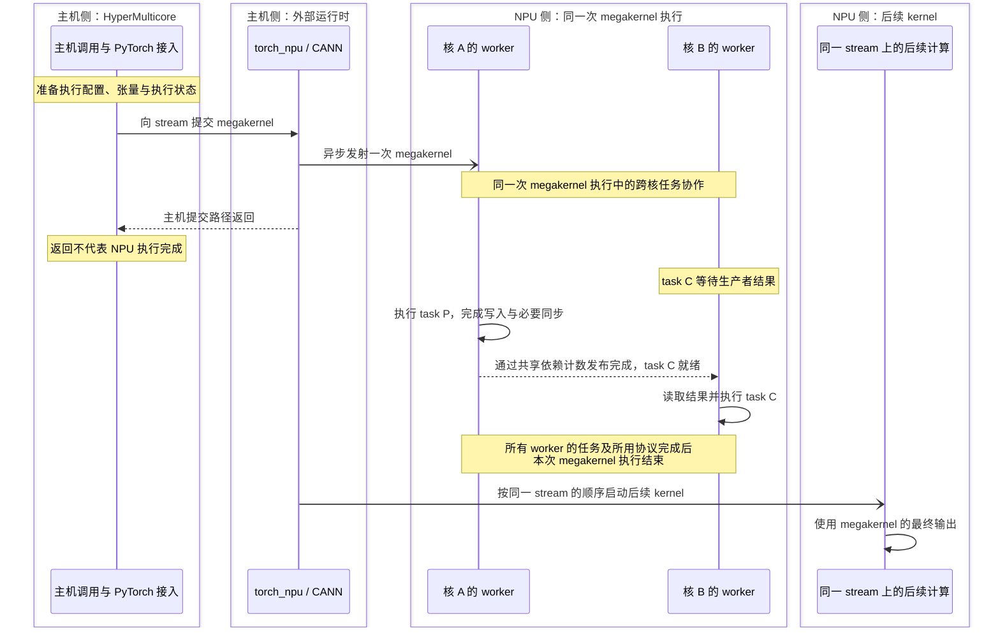

# HyperMulticore 架构

本文解释 megakernel 的编程方式、执行机制和状态管理，面向使用框架组织计算的开发者。
MegaMoE、MegaGate 和 MegaMHC 的接口与用法见[Python 接口导航](../hyper_multicore/README.md)。修改代码应遵守的职责、依赖与正确性约束见[架构规则](../.agent/rules/architecture.md)，开发流程与导航见[开发入口](../AGENTS.md)。

## 设计概述

HyperMulticore 是面向 Ascend NPU 的 megakernel 编程框架，支持在一次 kernel 执行中融合计算与通信操作。

模型计算通常由多个算子组成，算子之间通过张量传递数据。当这些操作分别通过独立 kernel 执行时，每次启动都会产生开销；并且以 kernel 为单位建立的执行依赖，还可能限制不同数据块之间的并行以及计算算子和通信算子之间的时间重叠。

HyperMulticore 在 NPU 侧维护计算与通信操作之间的依赖，将这些操作组织到同一次 megakernel 执行中，并允许分配到不同计算核、且依赖已满足的任务并行执行。这种融合执行不仅减少了独立 kernel 的启动次数，而且 NPU 侧的任务调度允许不同数据块在依赖满足后继续执行，为计算与通信的时间重叠提供机会。实际收益取决于任务粒度、依赖关系、硬件资源和通信负载。

为表达 megakernel 内的算子和依赖关系，开发者可以通过计算图编译或直接组装，在主机侧生成执行配置，描述各个任务（task）的操作、数据范围及执行顺序或依赖关系。megakernel 启动后，NPU 侧 runtime 读取配置，按阶段顺序或依赖关系调用对应任务的计算或通信实现，完成这些 task。

框架当前通过 PyTorch 扩展接入应用，MegaMoE、MegaGate 和 MegaMHC 基于上述机制实现各自的计算与自动微分衔接。

## 总体架构

HyperMulticore 将计算的准备与执行分布在主机和 NPU 两侧：主机侧确定要执行的任务及其依赖，准备数据与资源；NPU 侧根据这些描述执行任务。执行配置和本次调用的张量参数连接这两侧。

这里的 megakernel 主机侧指具体 megakernel 的计算描述、执行计划（plan）管理与调用逻辑。它描述计算操作、数据依赖和 task 划分，通过公共的任务编译或直接组装接口生成执行配置。调用时，它准备当前张量与工作存储；涉及跨 rank 通信时，还通过通信资源管理接口取得所需的存储和地址。

准备好的执行配置、张量和计算参数通过 PyTorch 接入提交。C++ binding 连接 PyTorch 接口与 CANN 算子入口，由调用路径按接口约定绑定设备参数，再经 torch_npu/CANN runtime 发射 megakernel。主机侧实现决定执行什么计算，接入层负责将本次调用的数据与参数交给 NPU 执行。

megakernel 启动后，NPU 侧 runtime 读取执行配置，按阶段顺序或依赖关系选择 task，并分发到对应实现。计算 task 由计算核适配器解释算子参数和 tiling（计算核内部的分块与资源配置），调用具体计算实现，并管理局部存储与同步，使结果满足后续消费条件。通信 task 则通过通信接口发起传输，由通信协议保证数据与完成通知的顺序。

下图展示上述模块之间的调用与数据传递。子框标明主机、NPU 及项目边界；实线表示调用或数据传递，虚线表示按需使用的通信关系，箭头上的文字说明传递内容或调用目的。

图中 NPU 部分展开的是 megakernel 执行路径。一次上层接口调用还可以组合 PyTorch 操作和普通 native 算子，后者指通过 CANN 入口提交、按自身计算流程执行的原生算子。需要自动微分时，前向实现将反向计算所需的状态保存到 autograd 上下文，反向实现再读取这些状态并提交相应计算；PyTorch 接入继续负责其中的设备提交。

诊断模块在上述主机提交和设备 task 执行边界采集时间或数据，主机侧的诊断接入代码为采集结果提供阶段与张量含义。采集会增加时间和存储开销，因此结果需与无打点执行区分。

## 任务与执行配置

### 任务描述与编排

算子描述要完成的逻辑计算，设备执行时还需要确定如何划分工作，以及各部分工作之间的依赖。HyperMulticore 用任务（task）表示 megakernel 内由 runtime 识别并分发执行的工作单元。例如，按数据块划分一个算子时，可以用多个 task 分别处理不同的数据块。这些 task 在同一次 megakernel 执行中完成，不分别启动独立 kernel。

主机侧在 task 描述中记录操作类型、数据位置、工作划分及计算参数的关联信息，NPU 侧 runtime 读取描述后调用对应的计算或通信实现。因此，task 描述与计算实现是分开的；需要等待其他任务结果时，描述中还会关联依赖事件。

主机侧还要安排这些 task 如何执行：将工作分配到执行队列，排列任务索引，并在需要时设置等待和发布的依赖事件及就绪阈值。这些安排称为任务编排，连同 task 描述一起构成执行配置。队列记录任务索引及其排列，依赖信息记录任务开始执行前需要满足的条件。NPU 侧 runtime 根据执行模式、队列范围和当前依赖状态选择 task，这一过程是运行时调度，实际执行顺序不一定与队列排列完全一致。

任务描述与编排信息可以通过两条路径生成。在图编译路径中，开发者用计算图描述逻辑算子及其张量关系，再由编译过程根据 task 划分和调度策略生成执行配置。对于工作划分与执行关系已经确定的流程，开发者也可以直接组装配置。两条路径生成的配置均由 NPU 侧 runtime 读取；图编译处理的是本项目的计算表示，当前不提供任意 PyTorch 计算图到 megakernel 的自动转换。

### 参数绑定

执行配置记录 task 描述、队列及依赖信息，每次调用则提供实际使用的输入、输出和工作存储。主机侧将可复用的配置与算子参数、tiling 参数保存为 plan。后续调用可以在 plan 的适用范围内复用它，通过参数绑定让这些描述用于本次调用的数据。

对于通过张量描述定位数据的 task，描述中记录参数位置、偏移及形状等信息。这里的参数位置是参数列表中的索引，指定使用本次调用传入的哪块存储；该位置上的设备地址指向当前存储，偏移等描述信息再定位其中要处理的数据。调用路径按约定传入地址后，计算核适配器便能用同一份描述访问不同调用的数据。

直接读取 native 算子参数的实现则按该算子的参数布局取得地址。两种方式都要求参数顺序和偏移单位在主机与 NPU 两侧保持一致。

复用 plan 时，当前张量仍需绑定，依赖计数等可写状态仍需为本次执行准备；这些存储的使用期与复用条件见[状态与资源](#状态与资源)。

### 任务划分与 tiling

主机侧的 task 划分逻辑确定一个任务处理哪些行、块或逻辑工作；计算核适配器根据 tiling 参数确定内部的分块处理方式及局部存储使用；CANN 算子主机侧则准备发射核数、实现选择和 workspace 需求。这些信息分别描述工作范围、计算核内部的执行方式和整次 kernel 的启动条件，需要相互匹配，才能覆盖完整计算范围并满足资源需求。

### 配置布局与容量

执行配置需要序列化后传到 NPU，由 NPU 侧读取配置头，并按布局约定解析队列和 task。两侧必须对同一段数据作出相同解释，因此 task 类型、字段含义、布局、单位及协议版本遵循同一约定。Python 和 C++ 可以分别声明表示，但不能各自扩展语义。

分配的存储不仅要容纳实际引用的 task 描述，也要覆盖执行期间对依赖计数的原子访问和临时工作数据（scratch）的访问范围。因此容量不能仅根据逻辑 task 数量推断，主机侧分配和 native 算子的边界检查需要覆盖这些实际访问。

阅读源码时，可以按下表定位本章介绍的概念；表中的结构和函数共同实现上述描述、编排与读取机制。

| 概念 | 对应实现 | 用途 |
| --- | --- | --- |
| 计算图与逻辑算子 | 主机侧 `ComputeGraph`、`OperatorNode` | 表达算子及其张量关系，作为图编译的输入 |
| task 描述 | 主机侧 `TaskDescC`；NPU 侧 `TaskDesc` | 记录操作类型、工作划分、参数关联及依赖事件 |
| 张量描述 | 主机侧 `TensorDescC`；NPU 侧 `TensorDesc` | 记录参数位置、偏移、形状等数据定位信息 |
| 执行配置 | 主机侧 `RuntimeConfigC` 及按容量生成的扩展类型；NPU 侧 `RuntimeHeader` 及配置读取函数 | 构造并序列化配置，在 NPU 侧读取配置头及各数据区域 |
| worker 队列视图 | NPU 侧 `WorkerQueue` 及队列读取函数 | 描述 worker 的任务索引范围、步长及就绪窗口等读取与选择条件 |

准确的字段、宽度与偏移由[主机侧定义](../hyper_multicore/scheduler/config.py)、[分配与序列化](../hyper_multicore/scheduler/runtime.py)及[NPU 侧读取实现](../hyper_multicore/ops/runtime/runtime_config.hpp)维护。

## 运行时模型

### 提交与执行

一次上层接口调用可以提交一个或多个 kernel，其中一次 megakernel 执行又包含多个 task。主机侧先选取或生成执行配置，准备当前张量和可写状态，再通过 PyTorch 接入将 kernel 提交到执行流（stream）。stream 为提交到同一条流上的设备工作建立执行顺序，主机提交返回不代表 NPU 已经执行完毕。

megakernel 开始执行后，NPU 侧 runtime 通过 worker（任务执行者）读取任务描述并调用对应的计算或通信实现。下图以运行在不同核上的两个 worker 为例：task P 生成数据，task C 等待并消费这些数据；同一 stream 上的后续 kernel 再使用本次 megakernel 的最终输出。

### 执行模式

worker 与 AIC（矩阵计算核）、AIV（向量计算核）执行实例的映射由执行模式确定。根据数据如何划分、任务之间是否需要跨 worker 协作，当前实现采用两种执行模式。

**顺序阶段执行**适合数据可独立分区、分区内计算顺序固定的流程。多个 worker 可以读取同一份阶段描述，在各自负责的数据分区上执行同一阶段序列。每个 worker 完成当前阶段所需的计算和局部同步后，再执行下一阶段，遍历完整个序列后结束。这种方式依靠分区内的执行顺序维持依赖，减少了跨 worker 的协调。

**依赖驱动执行**适合 task 间存在跨 worker 数据依赖的流程。主机侧将 task 安排到 AIC/AIV 执行队列，并描述需要等待的依赖。worker 在自己的队列范围内选择任务，确认依赖满足后执行，再按协议发布完成通知。worker 完成自己负责的全部任务后结束任务循环，当前实现不会从其他 worker 的队列取走任务。相比固定阶段顺序，这种方式允许更灵活的协作，同时需要维护依赖计数并承担任务选择的开销。

### 依赖同步与队列调度

在依赖驱动模式下，产生数据的 task 是生产者，使用这些数据的 task 是消费者。生产者完成相应工作后增加依赖事件的计数，消费者通过比较计数与阈值判断自己是否就绪。主机侧任务编排根据预期的生产者累计增量设置阈值，使就绪条件对应所需工作的完成。

计数达到阈值时，消费者需要的数据也必须已经可见。对于普通计算，计算核适配器先完成所需写入和同步，再由 worker 更新依赖计数。

对于带 signal 的传输，通信路径保证数据写入与通知的顺序，worker 不再重复增加计数。通信 signal 表示数据到达或远端读取完成等协议通知，也可以按约定直接更新任务依赖计数。通知的具体含义、计数存储及可见性要求由通信协议与 NPU 侧 runtime 共同约定，不能仅凭计数增加就推断所有数据访问已经完成。

依赖设置正确，还需要让生产者有机会执行。worker 可以按队列顺序执行任务并等待所需依赖，也可以在配置允许的就绪窗口内扫描候选任务，选择已满足依赖的 task。就绪窗口允许执行排列在后面的任务，但会增加扫描开销，也只能考虑窗口范围内的候选任务。

例如，生产者排在同一 worker 正在等待的消费者之后，严格顺序执行就会阻塞，即使计算图本身没有环。若生产者仍处于就绪窗口之外，扩大任务选择范围也不一定能解除阻塞。因此，主机侧编排必须同时考虑依赖关系、任务分配和队列顺序。具体执行入口见 [ops/runtime](../hyper_multicore/ops/runtime/)。

### 完成语义

一个 task 完成，只说明它承担的工作满足了后续消费条件，其他 worker 可能仍在执行。整次 kernel 结束后，远端使用者也可能继续访问共享数据。因此，结果消费和存储复用需要按相应的完成范围判断：

| 完成范围 | 含义与责任 |
| --- | --- |
| task 执行完成 | task 要求的计算、写入及同步操作完成，对应数据可被下游 task 消费；计算核适配或通信路径保证这些条件，依赖驱动模式还据此发布依赖事件 |
| kernel 执行完成 | 本次 kernel 的全部设备工作结束，并满足 kernel 所用协议的完成要求；NPU 侧 runtime 及协议实现协调参与的 worker，单个 worker 队列结束不足以代表全部完成 |
| 远端消费完成 | 远端使用者不再访问相关源数据；通信协议提供相应完成依据，资源管理器据此判断存储能否复用 |

本地后续计算如果提交到同一 stream，可以依靠流内顺序使用结果；跨 stream 使用时则需要建立显式依赖，例如在生产结果的 stream 上记录流事件（stream event），让消费结果的 stream 等待该事件。stream event 记录的是流上的执行进度，与 megakernel 内的任务依赖事件及通信 signal 具有不同的完成范围。

一次上层接口调用涉及多个 kernel 时，需要考虑所有相关设备工作的完成情况；这些完成条件如何用于判断存储的覆盖与释放，见[状态与资源](#状态与资源)。

## 状态与资源

执行配置可以服务多次调用，但每次调用使用的张量、依赖计数和中间数据有各自的使用期。主机侧根据当前设备、形状和计算参数选择适用的 plan，再准备本次调用所需的状态。plan 能否复用取决于其中的描述是否仍然适用，可写存储能否再次使用则取决于先前的访问是否已经完成。

计算过程还需要存放临时工作数据（scratch），例如计算核内部使用的中间结果。算子申请的 workspace 是执行所需的工作存储，可以容纳这些数据。本项目中，部分主机侧资源管理对象也以 workspace 命名，用于管理通信 buffer 和跨调用状态，因此其使用期可能长于一次 kernel 执行。

下表按数据的用途列出持有者及复用条件。同一块存储可能同时用于本次计算和后续反向，覆盖或释放时需要满足所有使用者的条件。

| 状态类别 | 所有权与有效期 | 复用或释放条件 |
| --- | --- | --- |
| plan | 主机侧持有 plan，维护设备、形状、容量与数值配置的适用范围；调用保留所使用的 plan | 描述仍适用时可复用；淘汰缓存不撤销已有调用的引用，也不意味着设备已停止访问相关存储 |
| 调用状态 | 主机侧调用路径准备输入、输出、依赖计数及中间数据，并在设备使用期间保留所需引用 | 可写区域在先前访问完成后才能覆盖；返回的输出由调用方按后续用途继续持有 |
| 反向保存状态 | autograd 上下文持有前向为梯度计算保存的张量和配置 | 只要仍可能执行反向，所需数据就须保持有效；不再用于反向且没有其他使用者后才可回收 |
| 共享资源 | 资源管理器安排跨调用的存储使用，通信层管理底层通信分配 | 下一次使用遵循资源使用协议；物理释放前须确认没有仍会使用该存储的调用或反向计算，并等待包括远端访问在内的在途操作完成 |
| 算子 workspace | native 算子申报所需工作存储，torch_npu/CANN 调用桥接管理执行期分配与提交 | 按调用桥接和分配器的 stream 生命周期回收，主机提交返回不能使存储提前失效 |

准备可写状态时，重置范围取决于数据的用途。任务依赖计数记录本次 kernel 的执行进度，需要在执行开始前初始化；跨调用握手状态则用于协调不同调用或 rank 的使用次序，需要保留协议仍然依赖的信息，只能在协议允许的初始化或重建时重置。即使两类状态位于同一块分配中，也不能一起按调用清零。

前向结束也不意味着中间数据已经不再使用。autograd 上下文保存张量引用时不会自动复制其数据；如果张量指向共享工作区，后续调用覆盖该区域就会改变反向读取的内容。因此，前向实现必须确保这些值在反向仍需使用期间保持有效。模型参数仍由所属模型或模块持有，将其绑定到 megakernel 不会转移所有权。

## 扩展边界

扩展一种计算能力时，主机侧需要描述计算操作及其依赖，NPU 侧需要提供对应的计算或通信实现。如果已有 task 类型能够表达所需操作，可以通过组合 task 和调整编排实现新的计算；新增操作类型时，则需要同时确定主机侧的参数描述和 NPU 侧的解释方式，队列选择与依赖等待仍可复用既有机制。

task 描述、参数绑定和完成条件连接了这些实现。替换计算核内部的算法或 tiling，只要仍满足原有的数据范围、数值和完成约定，就可以保持外部调用方式不变；如果改变 task 的划分、参数含义或完成通知，则需要同步调整依赖这些约定的生成方和使用方。下表列出不同变化的负责位置及需要共同保持的条件。

| 变化 | 负责的部分 | 需要共同保持的条件 |
| --- | --- | --- |
| 新增或替换 task 的计算实现 | 主机侧提供计算参数，计算核适配负责参数解释、tiling、局部存储与同步 | 参数生成方与计算实现对数据范围、参数含义和完成条件保持相同解释；计算结果满足 task 声明的数值约定 |
| 调整 task 划分与编排 | 主机侧生成任务、队列和依赖，NPU 侧 runtime 负责选择与执行 | 覆盖完整计算范围；划分变化后，依赖阈值与实际生产者增量仍匹配，队列安排允许生产者执行 |
| 扩展上层接口或前反向计算 | 上层接口实现定义计算组合及梯度逻辑，autograd 上下文保存反向状态；PyTorch 接入负责参数绑定和设备提交 | 接口实现、自动微分与参数绑定共同满足公开声明的输入输出和梯度语义，调用双方遵循相同的参数顺序与存储使用期约定 |
| 调整通信实现或协议 | 通信实现负责传输及通知，NPU 侧 runtime 使用协议约定的依赖计数，资源管理器安排存储复用 | 通信发布方与等待方对通知对应的数据可见性、计数增量和远端访问完成范围保持相同解释，资源管理器据此判断复用条件 |

当前图编译接口仍有适用范围限制：任务划分参数和部分容量计算包含专家数量、专家并行规模等信息。采用该路径的主机侧实现需要满足这些划分和容量约定，因而当前图编译接口还不能直接用于任意计算。

现有实现使用了不同的配置生成方式和执行模式。下表用于了解这些机制在具体计算中的组合方式，并提供源码入口。

| 实现 | 配置准备与执行模式 | 计算内容与状态 |
| --- | --- | --- |
| [MegaGate](../hyper_multicore/modules/mega_gate/) | 直接组装 AIV 顺序阶段 | PyTorch 投影配合 native 路由算子，另有适用条件下的 PyTorch 路径 |
| [MegaMHC](../hyper_multicore/modules/mega_mhc/)及[反向](../hyper_multicore/modules/mega_mhc_grad/) | 前反向分别构图，依赖驱动执行 | 残差混合与归一化计算，依赖计数及前向保存状态 |
| [MegaMoE](../hyper_multicore/modules/mega_moe/) | 精度后端构图与调度，依赖驱动执行 | 专家路由、跨 rank 传输及共享资源协议 |

这些实现的公共接口见[使用指南](../hyper_multicore/README.md)，MegaMoE 的专家数学、配置和资源使用见[MegaMoE 特性指南](mega_moe.md)，后端协作、任务调度与资源实现见[MegaMoE 设计](design/mega_moe_design.md)。环境与制品见[构建指南](build.md)，通信分配与重建见 [SHMEM](shmem.md)，采集方法见[诊断指南](diagnostics.md)，验证范围见[测试指南](../tests/README.md)。
