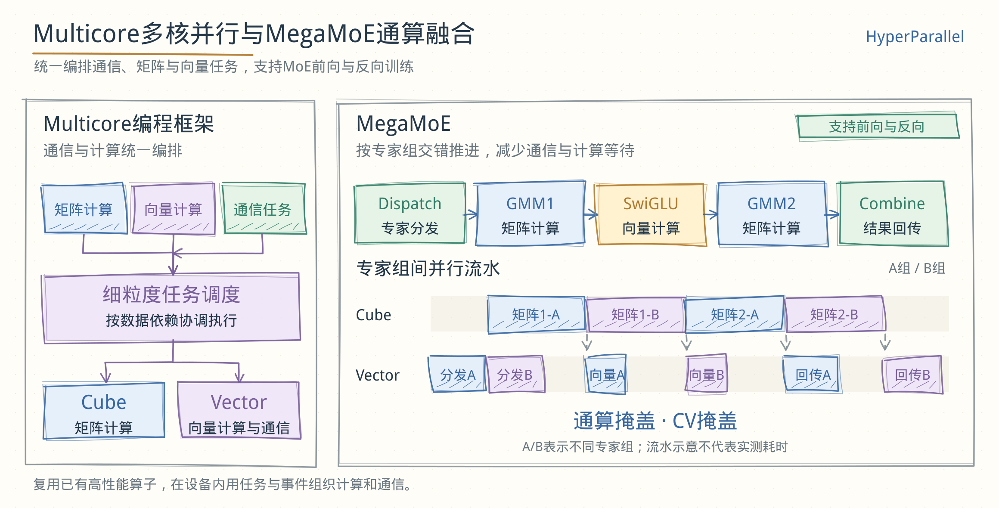
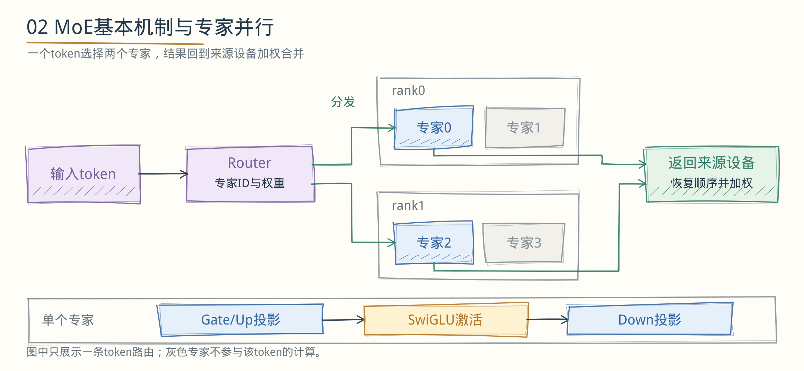
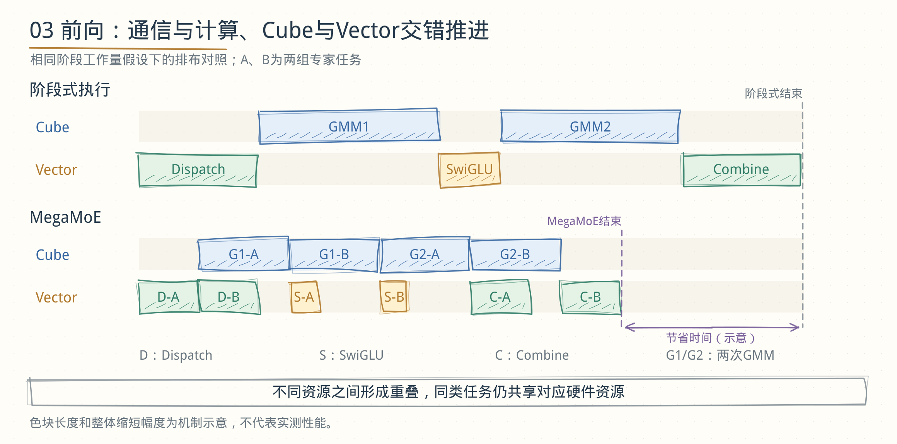
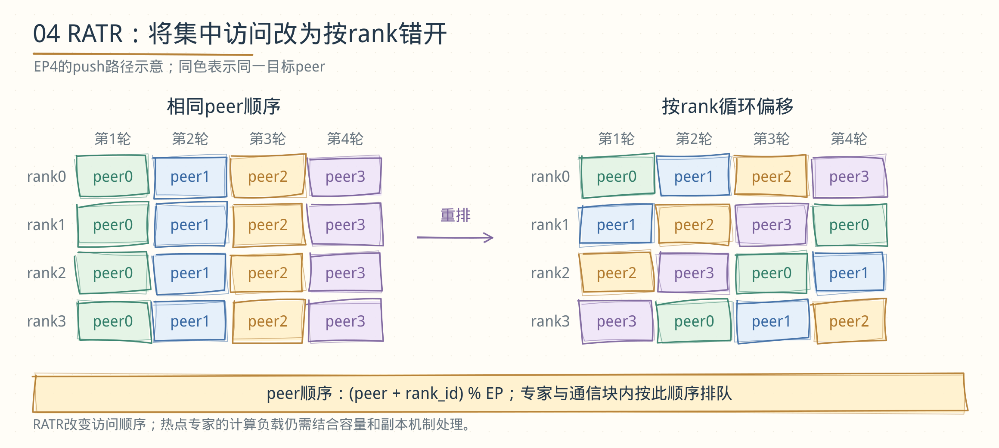
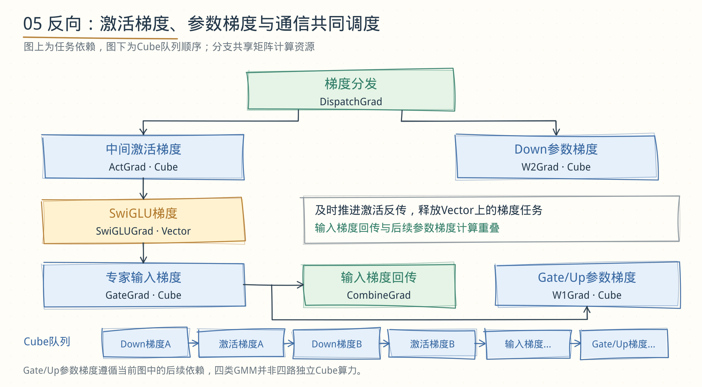
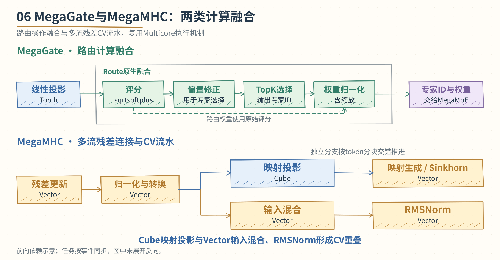

# HyperParallel-MegaMoE：面向昇腾的MoE训练通算融合

<!-- markdownlint-configure-file {"MD033":{"allowed_elements":["a","strong","sup"]}} -->

> HyperMulticore 的当前接口与接入方式见 [MegaMoE 使用指南](../mega_moe.md)。

## 前言

随着大模型向更大的参数规模、长上下文和原生多模态演进，模型结构也在持续调整计算与存储的分配方式。其中，混合专家架构（Mixture of Experts，MoE）通过仅激活部分专家，在扩大模型容量的同时控制每个token的计算量，已成为大模型扩展的主流技术路线之一。但稀疏激活也使执行过程更加复杂：token需要根据路由结果跨卡交换，不同专家的接收量动态变化，矩阵计算、激活计算与通信之间又存在连续的数据依赖。随着单项算子的性能逐步提高，**跨算子的等待、核资源的交替空闲和热点专家的执行长尾，越来越直接地影响MoE训练效率。**

昇腾AI Core提供了分工明确的Cube与Vector资源：Cube擅长矩阵乘加，Vector承担向量计算，并配合数据搬运完成设备侧通信。这为通信、矩阵计算和向量计算的并行执行提供了硬件基础，也要求软件能够细粒度地安排它们的执行顺序。针对MoE通算掩盖不足、Cube与Vector交替空闲的问题，我们基于HyperParallel的Multicore多核协同执行框架开发了**MegaMoE**，将不同专家组的通信与计算组织成流水，并覆盖专家训练的前向和反向流程。同一框架还提供MegaGate与MegaMHC，分别面向专家路由和多流残差连接。



图1　Multicore统一编排矩阵、向量与通信任务，MegaMoE将这套机制应用于专家训练。右侧展示前向的专家组间流水，反向沿用相同的任务与依赖机制。时间线为机制示意。

## 01 MoE基本机制

MoE将Transformer中的前馈网络扩展为多个专家，由Router为每个token选择少量专家，并生成对应的加权系数。在专家并行（Expert Parallel，EP）下，不同设备持有不同专家的参数，来源设备先根据路由结果整理token，再通过Dispatch把输入发送到专家所在设备；各专家完成前馈计算后，Combine将结果送回来源设备，随后恢复token顺序并加权合并。以常用的SwiGLU专家为例，计算包含gate/up投影、SwiGLU激活和down投影，多个专家的矩阵乘通过Grouped MatMul（GMM）组织。由此，专家执行形成了**Dispatch、GMM1、SwiGLU、GMM2、Combine**这条核心流程，其中两次GMM主要使用Cube，激活和通信任务使用Vector侧资源。<sup>[\[2\]](#ref2)</sup>



图2　以一个token选择两个专家为例，展示跨设备分发、专家计算与结果返回。单个专家仍按gate/up投影、SwiGLU、down投影的顺序计算。

这条流程的性能难点，在于各阶段的工作量、使用资源和就绪时间并不一致。在按完整算子同步的执行方式下，即使某组专家的输入已经到齐，也可能要等待其他专家的通信结束后再统一启动计算；矩阵乘期间Vector没有充分参与后续工作，激活计算期间Cube又可能空闲。路由不均衡会进一步放大这种等待：少数热点专家决定一个阶段的尾部耗时，其他专家却已经完成了自己的工作。因此，我们需要同时处理两个层次的衔接，一是不同设备之间的通信与本地计算重叠，二是同一设备内Cube与Vector的工作重叠。MoE拥有多组相对独立的专家任务，可以为这些资源提供交错执行的空间。为利用这种并行性，我们需要在保持数据依赖的同时，将不同阶段的任务统一编排到Cube与Vector上。

## 02 Multicore：面向昇腾的多核协同执行框架

针对上述跨算子等待与核资源利用不足的问题，我们设计了Multicore多核协同执行框架，将一段计算表达为包含矩阵、向量和通信任务的计算图。框架将算子数值实现与执行编排分开：底层继续调用已有GMM、SwiGLU等高性能实现，上层则描述各项任务的数据范围、目标核类型及上下游依赖。同一阶段可以按数据块拆为多个任务，并依据实际计算结构建立阶段间的数据依赖，使输入已经就绪的部分先推进。<strong>这种设计把优化重点从单个算子延伸到跨算子的资源分工与执行顺序。</strong>不同计算结构可以复用同一套任务表达，再针对各自的数据流安排流水。<sup>[\[1\]](#ref1)</sup>

执行过程分为Host侧规划与设备侧运行。Host根据任务图和切分配置生成任务描述、Cube/Vector队列及事件阈值，并结合具体场景重排任务顺序；设备上的Worker沿预排队列取任务，在对应完成计数达到依赖阈值后执行，结束时更新下游事件。由此，不同数据块可以按依赖衔接后续阶段，其他就绪任务则在另一类核资源上推进。任务队列、依赖同步和诊断能力由框架统一提供，新增MegaKernel可以复用这些机制，再围绕自己的计算结构设计流水。在这一框架下，MegaMoE围绕专家前反向的数据流设计通算与CV流水，MegaMHC则利用多流残差连接中的独立分支组织CV重叠。<sup>[\[1\]](#ref1)</sup>

## 03 MegaMoE技术方案

### 3.1 前向：通信与计算、Cube与Vector协同流水

在MegaMoE中，我们将Dispatch到Combine的五个阶段组织进同一次核心内核执行，并为每个阶段生成与其数据依赖相匹配的任务。GMM1把专家的gate和up投影合并执行，Vector上的SwiGLU消费投影结果，GMM2再将激活映射回隐藏维度；通信任务则把来源token送入专家，并将专家输出写回。对于同一组专家，这些先后关系始终保留；可利用的并行性来自不同专家组之间的数据就绪差异。我们据此安排Cube与Vector队列，使某组专家进入计算时，其他组的分发、激活或回传能够在另一类资源上继续推进。公开模块还负责路由整理和输出恢复，**一次核心内核执行的融合范围是Dispatch到Combine，而不是将整个MoE层的所有外围操作都压成一次调用。**<sup>[\[2\]](#ref2)</sup>



图3　相同阶段工作量假设下的执行排布。专家组A的矩阵计算可与组B的分发重叠，A的激活可与B的矩阵计算重叠，A的结果回传也可与B的后续计算重叠。两条结束虚线标出各自完成位置，间隔表示流水带来的执行时间缩短，仅为机制示意。

例如，专家组A的输入就绪后，Cube开始其gate/up投影，Vector继续处理组B的Dispatch；A的投影完成后，Vector执行A的SwiGLU，此时Cube转去计算B的投影；随后，A的down投影与B的激活、A的Combine与B的down投影又能形成重叠。这里既有通算掩盖，也有CV掩盖。为了让这种排布成立，我们需要同时选择通信切分粒度、计算任务粒度和事件阈值：通信分得更细，可以提高数据到达的及时性，但也会增加任务与信号开销；通信与激活都使用Vector，过度安排通信还可能推迟SwiGLU。因此，<strong>MegaMoE的调度目标是缩短整条依赖路径上的等待，而不是简单地增加并发任务数量。</strong>通信块是否足以释放后续GMM，由执行计划中的依赖组决定，不能把一个通信块的到达直接等同于任意后续计算就绪。<sup>[\[2\]](#ref2)</sup>

### 3.2 单边通信与Rank感知调度

为了让跨卡数据传输直接参与核内流水，我们使用基于SHMEM对称内存的单边通信，将传输任务与计算任务放进同一套依赖机制。路由元数据给出数据的位置和长度，设备侧通信任务完成搬运并满足写入顺序要求后，再向对应事件发布完成信号，后续任务据此读取输入。相较于由Host逐阶段下发通信和计算，这种方式把数据到达与消费者推进直接连接起来。当前Dispatch支持push和pull两种模式，分别由来源设备主动写入、由专家所在设备主动读取；两者的Combine均把结果写回来源设备。它们保持相同的专家计算语义，但来源区、接收区和容量安排有所不同，可以结合负载与显存需求选择。<sup>[\[3\]](#ref3)</sup>



图4　以EP4的push路径为例，RATR循环错开不同来源rank的peer访问顺序。图中轮次表示排队顺序，实际传输时序仍取决于数据依赖、负载和互联。

进入多卡场景后，仅让通信异步执行还不够，还需要考虑各rank在同一时段访问谁。如果多个来源始终采用相同peer顺序，流量容易集中到同一目标，使其接收与后续计算形成长尾。为此，我们设计了**Rank感知任务重排RATR（Rank-Aware Tile Reordering）**，按rank编号循环错开peer顺序，并在专家和通信块维度重排Vector队列，使相近时段的访问尽量分散。RATR不改变路由结果，也不增加通信数据量，处理的是访问顺序造成的流量集中；它与前向流水配合，目标是让不同专家组更及时地获得输入。专家本身接收token过多造成的计算不均衡，则需要与容量管理和专家副本等机制结合处理，两类问题不能仅靠同一项队列重排解决。<sup>[\[3\]](#ref3)</sup>

### 3.3 反向：将通算融合扩展到完整训练流程

MoE训练的反向除了回传输入梯度，还要完成gate/up、down参数梯度，以及路由权重梯度计算。我们为此建立了独立的反向任务图，将DispatchGrad、四类GMM、SwiGLUGrad和CombineGrad组织进统一调度。四类GMM分别处理down参数梯度、中间激活梯度、专家输入梯度和gate/up参数梯度，其中激活梯度形成继续向前一层传播的依赖链，参数梯度则用于后续优化器更新，二者在时序上的紧迫程度有所不同。<strong>在目前对比的昇腾开源MegaMoE实现中，HyperParallel-MegaMoE是唯一同时提供完整前向与反向训练路径的实现。</strong>这一比较范围在文末列明，训练支持也体现在输入、专家参数和路由权重梯度能够接回原模型的自动微分流程。<sup>[\[4\]](#ref4)[\[7\]](#ref7)</sup>



图5　反向图与当前Cube队列的对应关系。down参数梯度和中间激活梯度按专家组交错，专家输入梯度产生后启动回传，再与gate/up参数梯度计算重叠。四类GMM共享Cube资源。

在反向前半段，down参数梯度和中间激活梯度都使用已经分发到专家侧的输出梯度，我们按专家组交错排列这两类GMM，使Vector能够较早获得可执行的SwiGLUGrad任务。在后半段，SwiGLUGrad生成投影梯度，随后计算专家输入梯度并启动CombineGrad；gate/up参数梯度安排在当前执行图的相应依赖之后，与输入梯度回传形成通算重叠。这里的独立分支仍然共享Cube，DAG上的分叉不等于新增一组独立矩阵算力。前向保存的专家输入、投影结果与激活，也需要在对应反向图完成前保留。我们通过明确计算依赖和存储归属，使反向任务在梯度分发、激活反传、参数梯度计算与输入梯度回传之间形成可验证的流水。<sup>[\[4\]](#ref4)</sup>

路由权重的梯度则位于来源端的加权合并路径上。来源token的输出梯度先按各条路由权重分配给对应专家，再进入专家侧的反向；路由权重自身的梯度，需要结合返回的专家结果与来源输出梯度计算。由于一个token可以同时选择多个专家，输入梯度也要按原路由映射汇总各条专家路径的贡献。这些操作通过输出恢复和自定义自动微分接口与核心反向连接，构成完整的训练语义。验证时，除检查四类GMM结果外，还应同时核对路由权重梯度与来源输入梯度；loss缩放、分布式梯度归约及优化器更新仍遵循原训练框架的约定。<sup>[\[4\]](#ref4)</sup>

### 3.4 模型接入

我们通过`MegaMoeExperts`封装路由整理、专家执行与输出恢复，接入时可以根据模型配置直接构建专家模块。下面传入隐藏维度、专家中间维度、全局路由专家数和TopK，专家参数按EP组划分到各设备；`ep_group`使用模型已经建立的专家并行通信组。已有Router继续提供专家编号和权重，辅助loss、共享专家及外层并行逻辑仍由原模型组织，输入输出也可以保持原有的批次与序列形状。当前分支的专家路径使用Torch/torch_npu和BF16，以eager方式执行，模块应在构造优化器之前完成创建与设备迁移。<sup>[\[5\]](#ref5)</sup>

```python
import torch
import torch_npu
from hyper_parallel.core.multicore import MegaMoeExperts

experts = MegaMoeExperts(
    hidden_size=hidden_size,
    intermediate_size=intermediate_size,
    num_experts=num_experts,  # 全局路由专家数
    top_k=top_k,
    ep_group=ep_group,
).to(device="npu", dtype=torch.bfloat16)

# topk_ids和topk_weights由原模型的Router产生。
routed_output = experts(
    hidden_states,
    topk_ids=topk_ids,
    topk_weights=topk_weights,
)
output = routed_output + shared_expert(hidden_states)
```

对于已有模型，也可以通过`from_module`迁移已经加载权重的本地专家模块，后续调用方式与直接构建相同。当前接口支持约定的GroupedExperts SwiGLU布局，会将gate/up权重合并并调整矩阵布局，创建新的专家参数；因此，转换应在原权重完成初始化或加载之后、构造优化器之前进行。分布式接入时仍显式传入同一个EP组，使参数归属与通信域一致，已有优化器状态则需要单独迁移。<sup>[\[5\]](#ref5)</sup>

```python
experts = MegaMoeExperts.from_module(
    old_grouped_experts,
    top_k=top_k,
    ep_group=ep_group,
)
```

实际训练中的输入长度与专家负载都会变化，执行计划也需要与当次路由对应。我们从实际输入维护token容量，按容量桶复用计划，并根据本rank实际接收量分配计算中间数据；push路径遇到热点接收超限时协调扩容，保持路由数据完整。对于多个配置兼容、串行执行的MoE层，可以在首次执行前共享workspace和计划缓存，减少重复预留的资源，但各层的参数、梯度及待反向激活仍然独立。已有FSDP或参数管理器继续持有权重时，也可以使用无内置参数的执行器，在调用时传入当前已unshard的本地专家权重。接入验证应覆盖输出、输入与路由梯度、专家参数梯度和单步更新，先保证训练语义一致，再比较执行效率。<sup>[\[5\]](#ref5)</sup>

## 04 MegaGate与MegaMHC

### 4.1 MegaGate：路由计算融合

MoE在专家执行之前，还需要通过Router完成专家评分与选择。评分、偏置修正、TopK和权重归一化通常由多个小算子串接完成，单项计算量不大，多次启动与中间结果读写却会逐层累积。针对这一开销，我们设计了MegaGate，将投影后的路由处理融合为原生Route，并提供对应的RouteGrad接回训练反向。<strong>MegaGate的重点是减少路由流程中的零散调用和中间处理开销。</strong>当前原生融合覆盖sqrtsoftplus评分路径，线性投影继续使用Torch；选择阶段使用修正后的评分，路由权重仍基于原始评分计算，保持模型原有语义。接入时可通过MegaGate.from_module复用已有Router参数，其专家ID与权重直接交给MegaMoE。<sup>[\[8\]](#ref8)</sup>

### 4.2 MegaMHC：多流残差连接的融合与CV流水

mHC将单条残差连接扩展为多条残差流，通过可学习映射完成输入混合、子层输出回写与残差流之间的信息传递。这一结构在每个连接边界包含残差更新、归一化、映射投影与映射生成等操作，矩阵计算和向量计算交替出现，也存在可以独立推进的分支。我们面向四流shifted mHC实现了MegaMHC，在保留跨层状态与数学定义的基础上，将这些操作纳入Multicore统一编排：残差更新与归一化转换完成后，Cube执行映射投影，Vector推进输入混合与RMSNorm，投影结果就绪后再完成映射生成及Sinkhorn处理。<strong>利用shifted布局中的分支独立性，映射投影可以与输入混合、RMSNorm形成CV重叠。</strong>我们进一步按token分块组织任务，以事件协调数据就绪和中间缓冲复用，减少按完整阶段串行执行产生的等待。MegaMHC同时提供前向和反向路径，已有兼容mHC模块可通过MegaMhc.from_module迁移，Attention、FFN等子层计算继续由原模型执行。<sup>[\[9\]](#ref9)</sup>



图6　MegaGate的线性投影独立执行，原生Route融合后续路由处理；MegaMHC利用shifted布局，将映射投影与输入混合、RMSNorm分支交错推进。图中仅展示前向依赖。

## 05 性能收益

### 5.1 算子级收益

MegaMoE主要通过减少核心执行链的launch边界、提高通算与CV重叠程度来缩短专家执行时间。评价时需要同时观察核心流程和完整模块：前者帮助定位融合本身的效果，后者包含路由整理、元数据准备和输出恢复，更接近模型实际开销。不同EP布局、每卡token数、专家负载分布和通信模式会改变流水空间，首次构建计划、进入新容量桶和扩容也会引入额外成本。因此，算子对照应在一致配置下进行，并区分初始化与稳定执行区间。下表保留MegaMoE前向、反向和完整模块三种边界，同时增加MegaGate路由与MegaMHC连接边界的单项对照，分别记录各组件的融合效果。

| **测试项目** | **常规实现** | **融合实现** | **加速比** |
| :--- | :---: | :---: | :---: |
| 前向核心流程 | TODO | TODO | TODO |
| 反向核心流程 | TODO | TODO | TODO |
| 完整MoE模块前向与反向 | TODO | TODO | TODO |
| MegaGate路由前向与反向 | TODO | TODO | TODO |
| MegaMHC边界前向与反向 | TODO | TODO | TODO |

### 5.2 Profiler精细收益分析

外层Profiler能够记录大内核的总耗时，我们还在Multicore内部提供了按Worker采集的任务执行、依赖等待和事件触发时间线，并支持导出后与外层轨迹联合分析。它可以进一步回答通信是否仍暴露在关键路径上、SwiGLU是否因Vector竞争被推迟、某组专家为何成为长尾等问题，而不是只看到一个融合后的大色块。重叠程度应按不同核上区间的实际覆盖关系分析，不能直接累加并发任务耗时。<sup>[\[6\]](#ref6)</sup>

<strong>TODO：</strong>补充算子级实测数据、前反向内部Profiler时间线，以及整网训练的单步时间、吞吐和显存对照。

### 5.3 整网训练收益

整网训练还受到Attention、参数通信、共享专家及优化器等阶段影响。我们将在相同模型配置、精度与并行策略下，关闭诊断后测量稳定区间的单步时间和吞吐，同时检查输出、梯度及单步更新的一致性。对于不同token规模与专家负载，应分别记录对应的EP布局和通信模式，再结合算子与内部Profiler结果解释整网变化，并比较仅启用MegaMoE与三组件同时启用的结果，评估各项融合在完整训练中的综合效果。

| **模型、并行与融合配置** | **常规实现单步时间** | **融合实现单步时间** | **训练吞吐** | **整网加速比** |
| :--- | :---: | :---: | :---: | :---: |
| 仅MegaMoE（配置TODO） | TODO | TODO | TODO | TODO |
| 三组件同时开启（配置TODO） | TODO | TODO | TODO | TODO |

## 06 总结与展望

围绕MoE训练中的跨卡通信与CV资源交替等待，我们基于Multicore设计了MegaMoE，将专家前反向的通信、矩阵计算和向量计算组织为可交错推进的任务。前向通过专家组间流水和RATR减少等待，反向将激活梯度、参数梯度与梯度回传统一编排，并通过MegaMoeExperts连接已有Router与自动微分流程。<strong>MegaMoE的重点是改善完整专家训练流程的执行效率。</strong>MegaGate进一步融合专家路由中的小算子，MegaMHC则利用多流残差连接的分支独立性组织CV流水，三者复用同一框架的执行与诊断能力。

针对热点专家造成的负载长尾，我们还基于Multicore实现了**自适应专家副本**，相关能力正在验证中。方案根据当前路由负载评估可获得的均衡收益与新增的权重通信成本，**仅在均衡收益大于权重通信成本时启用副本**。副本在有余力的设备上承接部分token，本地专家可以在副本参数复制期间先推进分发与计算；副本的gate/up参数和输入就绪后即可开始投影，down参数继续复制，再按依赖衔接后续计算与回传。本地专家的通信和向量计算也可与副本的矩阵计算交错，**实现额外的副本专家通算与本地专家通算的相互掩盖**，副本梯度最终回到原卡，由原卡统一管理参数更新。permute/unpermute融合与shared experts融合也在验证中，MegaFFN、MegaDSA及基于Python-AST的前端正在开发中。

## 参考资料

本文实现依据feat/mega-kernel-examples分支的d5dc4462bb0c提交。总览图根据同项目新闻稿配图重绘并移除收益区，其他流程图同样按实现绘制；时间线均为机制示意。

1. <a name="ref1"></a>[Multicore组件与公开契约](https://github.com/zhangfeiran/hyper-parallel/blob/d5dc4462bb0c7999d0e18f08a0027312cbfd5a3a/hyper_parallel/core/multicore/README.md)、[设备Worker运行时](https://github.com/zhangfeiran/hyper-parallel/blob/d5dc4462bb0c7999d0e18f08a0027312cbfd5a3a/hyper_parallel/core/multicore/ops/runtime/worker_kernel.h)。
2. <a name="ref2"></a>[前向执行图](https://github.com/zhangfeiran/hyper-parallel/blob/d5dc4462bb0c7999d0e18f08a0027312cbfd5a3a/hyper_parallel/core/multicore/modules/mega_moe/forward/graph.py)、[通信任务](https://github.com/zhangfeiran/hyper-parallel/blob/d5dc4462bb0c7999d0e18f08a0027312cbfd5a3a/hyper_parallel/core/multicore/tasks/alltoall.py)、[GMM任务与依赖](https://github.com/zhangfeiran/hyper-parallel/blob/d5dc4462bb0c7999d0e18f08a0027312cbfd5a3a/hyper_parallel/core/multicore/tasks/gmm.py)。
3. <a name="ref3"></a>[RATR与反向队列重排](https://github.com/zhangfeiran/hyper-parallel/blob/d5dc4462bb0c7999d0e18f08a0027312cbfd5a3a/hyper_parallel/core/multicore/scheduler/scheduler.py)、[PUT搬运与完成信号](https://github.com/zhangfeiran/hyper-parallel/blob/d5dc4462bb0c7999d0e18f08a0027312cbfd5a3a/hyper_parallel/core/multicore/ops/hyper_mega_moe/op_kernel/put_mem_signal/put_mem_signal_kernel.cpp)。
4. <a name="ref4"></a>[反向执行图](https://github.com/zhangfeiran/hyper-parallel/blob/d5dc4462bb0c7999d0e18f08a0027312cbfd5a3a/hyper_parallel/core/multicore/modules/mega_moe/backward/graph.py)、[自动微分与激活保存](https://github.com/zhangfeiran/hyper-parallel/blob/d5dc4462bb0c7999d0e18f08a0027312cbfd5a3a/hyper_parallel/core/multicore/modules/mega_moe/function.py)。
5. <a name="ref5"></a>[模型与权重迁移示例](https://github.com/zhangfeiran/hyper-parallel/blob/d5dc4462bb0c7999d0e18f08a0027312cbfd5a3a/hyper_parallel/core/multicore/examples/README.md)、[训练接入指南](https://github.com/zhangfeiran/hyper-parallel/blob/d5dc4462bb0c7999d0e18f08a0027312cbfd5a3a/hyper_parallel/core/multicore/docs/mega_moe_integration.md)。
6. <a name="ref6"></a>[MegaKernel Profiling指南](https://github.com/zhangfeiran/hyper-parallel/blob/d5dc4462bb0c7999d0e18f08a0027312cbfd5a3a/hyper_parallel/core/multicore/docs/mega_kernel_profiling.md)。
7. <a name="ref7"></a>反向能力的比较范围为HyperParallel、[CANN公开MegaMoE路径](https://gitcode.com/cann/ops-transformer/tree/master/mc2/mega_moe)与[DeepGEMM-Ascend公开接口](https://github.com/deepseek-ai/DeepGEMM-Ascend/blob/main/csrc/apis/mega_moe.hpp)。在该范围内，后两者公开MegaMoE路径以融合前向为主，未见对应完整反向接口；比较不扩展到各库的其他训练算子。
8. <a name="ref8"></a>[MegaGate模块与路由语义](https://github.com/zhangfeiran/hyper-parallel/blob/d5dc4462bb0c7999d0e18f08a0027312cbfd5a3a/hyper_parallel/core/multicore/modules/mega_gate/module.py)、[原生Route与反向接口](https://github.com/zhangfeiran/hyper-parallel/blob/d5dc4462bb0c7999d0e18f08a0027312cbfd5a3a/hyper_parallel/core/multicore/modules/mega_gate/function.py)。
9. <a name="ref9"></a>[MegaMHC任务图与CV流水](https://github.com/zhangfeiran/hyper-parallel/blob/d5dc4462bb0c7999d0e18f08a0027312cbfd5a3a/hyper_parallel/core/multicore/modules/mega_mhc/graph.py)、[模块与训练接口](https://github.com/zhangfeiran/hyper-parallel/blob/d5dc4462bb0c7999d0e18f08a0027312cbfd5a3a/hyper_parallel/core/multicore/modules/mega_mhc/module.py)。

相关技术阅读：[Hazy Research：Look Ma, No Bubbles!](https://hazyresearch.stanford.edu/blog/2025-05-27-no-bubbles)、[Cohere：Inside the megakernel serving engine for North Mini Code](https://cohere.com/blog/megakernels)、[Mirage作者博客：Compiling LLMs into a MegaKernel](https://zhihaojia.medium.com/compiling-llms-into-a-megakernel-a-path-to-low-latency-inference-cf7840913c17)、[Triton-distributed：EP All-to-All Fused Megakernel](https://triton-distributed.readthedocs.io/en/latest/kernels/nvidia/ep_all2all_fused.html)。
