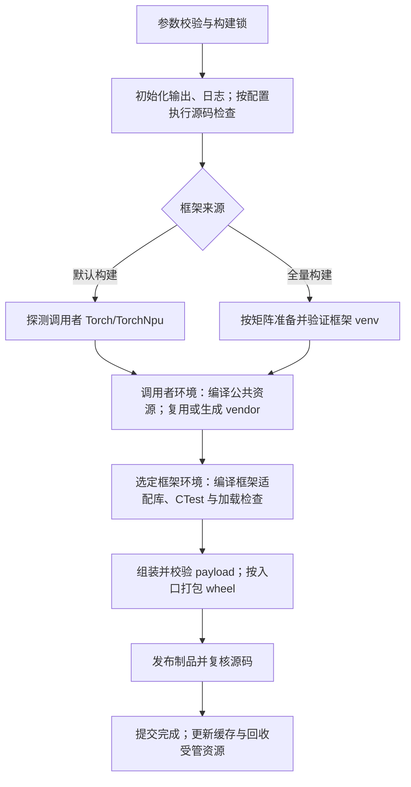

# 构建与安装

日常开发从[默认构建](#默认构建)开始；已有制品可直接[安装 wheel](#安装已有-wheel)，需要覆盖多个框架版本时使用[全量构建](#全量构建)。
本文命令默认从仓库根目录执行，`/path/to/...`、`<version>` 等占位符需替换为实际路径或值。

## 目录

- [源码构建](#源码构建)
- [安装与验证](#安装与验证)
- [其他构建方式与参数](#其他构建方式与参数)
- [日志与失败恢复](#日志与失败恢复)
- [制品与构建参考](#制品与构建参考)
- [ascend950 MegaMoE 源码构建](#ascend950-megamoe-源码构建)

## 源码构建

源码构建生成可安装的 wheel 和供源码验证的本地 native 资源（payload）。

### 环境准备

源码构建需要以下系统环境。CANN 自身的依赖按所用工具链的发行要求准备。

| 环境 | 要求 |
| --- | --- |
| 系统 | Linux，具有匹配 CPU 架构的 CANN 工具链 |
| Python | >=3.10，具有开发头文件 |
| Ascend | CANN toolkit/ops，包含 `bisheng`、`asc_opc` |
| 编译工具 | GCC/G++、配套的 CMake/CTest >=3.20、GNU Make、Git、binutils 和常用 GNU 工具 |

### 默认构建

默认构建使用当前 Python 环境中的 Torch/TorchNpu（Ascend 后端）。先按所用 CANN 环境安装配套的框架，
再激活 CANN、安装项目依赖并构建。

构建获锁后会清空 `dist/` 并替换上次日志；制品提交前失败或取消还会清除正式 payload。
制品提交指产物通过最终校验并确认发布。
需保留的制品和日志应提前归档，详细行为见[清理与保留规则](#清理与保留规则)。

```bash
source /path/to/cann/set_env.sh
python -m pip install -r requirements.txt -r requirements-build.txt
python -c 'import torch, torch_npu; print("Torch:", torch.__version__); print("TorchNpu:", torch_npu.__version__)'
bash build.sh --jobs 24
```

默认构建不安装或升级框架，也不读取框架矩阵。构建成功后，`dist/` 中生成适用于当前 Torch/TorchNpu 版本组合的 wheel，
payload 位于 `build/native/payload/hyper_multicore/`。
生成的 wheel 可安装到运行环境，本地 payload 可直接用于源码验证。

## 安装与验证

### 安装已有 wheel

先激活目标运行环境，准备 Linux、匹配 wheel 的 Python ABI/CPU 架构、Torch/TorchNpu，以及兼容的 CANN/驱动。
[运行依赖](../requirements.txt)也需提前安装；下面的 `--no-deps` 不会补装依赖。
在 Bash 中执行以下命令，wheel 路径使用构建命令打印的实际路径，或已有制品的保存路径。

```bash
source /path/to/cann/set_env.sh
python -m pip install --no-deps "/path/to/hyper_multicore-<version>-<python>-<abi>-<platform>.whl"
source "$(command -v hyper_multicore_set_env.bash)"
```

激活脚本设置项目 vendor 的搜索路径，须在导入 Torch/TorchNpu 之前执行。
更换制品或环境后使用新的 Python 进程。安装、导入和算子调用均不触发 native 编译或依赖下载。

### 验证安装

在源码目录外执行，并从 `PYTHONPATH` 移除会遮蔽目标安装的路径：

```bash
hyper_multicore_build_info
python -c 'import hyper_multicore; print(hyper_multicore.__file__)'
```

`hyper_multicore_build_info` 展示构建环境并校验包内清单和资源完整性，无需导入 Torch/TorchNpu。
包来源应指向目标安装位置。需要查看完整构建记录和文件列表时，见[查询构建记录与源码包](#查询构建记录与源码包)。

以上检查安装与加载来源；设备执行使用[双卡最小 NPU 示例](../examples/README.md#运行单层-moe-示例)验证，
示例完成前向、反向和设备通信。
完整用例及执行方法见[测试指南](../tests/README.md#npu-用例执行)。

### 激活本地 payload

已构建的源码目录可直接使用本地 payload，无需安装 wheel。在启动模型的 shell 中激活兼容的 Python 环境和 CANN，再执行以下命令：

```bash
source /path/to/cann/set_env.sh
hmc_checkout=/path/to/hyper-multicore
source "$hmc_checkout/build/native/payload/hyper_multicore/lib/set_env.bash"
export PYTHONPATH="$hmc_checkout${PYTHONPATH:+:$PYTHONPATH}"
python -c 'from hyper_multicore import MegaMoeExperts; print(MegaMoeExperts.__name__)'
```

payload 的 `set_env.bash` 配置 native 库和 vendor 搜索路径，须在启动 Python 前执行。
在源码仓根目录直接运行 `python -c` 或 `python -m` 验证时，Python 已能找到源码，可以省略 `PYTHONPATH` 设置。
从模型仓启动时，将 HyperMulticore 的源码仓根目录加入 `PYTHONPATH`。
部署时保留源码目录和 `build/native/payload/` 的相对位置，目标 Python/Torch/TorchNpu ABI、SoC 和系统库须与制品兼容。
同一个 Python 进程使用一套制品。设备验证见[测试指南的源码模式](../tests/README.md#npu-系统测试)。

## 其他构建方式与参数

### 全量构建

需要为多个 Torch/TorchNpu 配对生成一个 wheel 时，使用 `--all`。
准备前述[系统工具链](#环境准备)和 Python 的 `venv`/pip 能力后，在启动构建命令的 Python 环境中执行。
该模式沿用默认构建的[输出清理规则](#清理与保留规则)：

```bash
source /path/to/cann/set_env.sh
python -m pip install -r requirements-build.txt
bash build.sh --all --jobs 24
```

该环境无需预装 Torch/TorchNpu；构建器按[框架矩阵](../hyper_multicore/_build/frameworks.lock.json)创建或复用 venv，
安装各目标的框架及补充依赖。公共 CANN 编译仍使用启动命令的 Python，框架 venv 不会补装调用者环境的依赖。

全量构建使用当前 Python ABI、CPU 架构和已激活的 CANN，输出位置与默认构建相同。
成功后，一个 wheel 包含全部矩阵目标；安装时切换到配套的运行环境，再按[安装已有 wheel](#安装已有-wheel)操作。

两种构建模式都使用当前 CANN。仅全量构建在配置 `reference_cann` 时比较参考版本，实际版本不同或未知则告警并继续。

### SoC 选择

默认包含所有支持的 SoC。使用 `--soc-list` 选择目标。

| 芯片型号 / 构建目标 | 内核架构 |
| --- | --- |
| `ascend910b` | `arch22` |
| `ascend910_93` | `arch22` |
| `ascend950` | `arch35` |

```bash
# 构建 ascend910b 和 ascend910_93。
bash build.sh --soc-list ascend910b,ascend910_93 --jobs 24

# 选择 ascend950。
bash build.sh --soc-list ascend950 --jobs 24
```

### 仅生成 native payload

已准备默认构建环境时，可使用组件入口省略 wheel 打包，沿用统一控制器的[输出清理规则](#清理与保留规则)：

```bash
bash hyper_multicore/build.sh --soc-list ascend910b --jobs 24
```

输出仍为 `build/native/payload/hyper_multicore/`；`--jobs` 默认取 `nproc`，`--clean` 清理所选 vendor 缓存。
生成后按[激活本地 payload](#激活本地-payload)使用。

### 构建参数

下表适用于根入口 `bash build.sh`。payload 组件入口 `bash hyper_multicore/build.sh` 的公开构建参数为 `--soc-list`、`--jobs` 和 `--clean`。

| 参数 | 默认值 | 作用 |
| --- | --- | --- |
| `--all` | 关闭 | 根入口遍历框架矩阵；关闭时使用当前 Torch/TorchNpu |
| `--soc-list` | `ascend910b,ascend910_93,ascend950` | 选择目标 SoC，默认和全量构建均适用 |
| `--jobs` | 根入口 Python 的 `os.cpu_count()` | 正整数编译预算，分配方式见[并行预算](#并行预算) |
| `--tests on/off` | 默认构建为 `off`，全量构建为 `on` | 控制轻量构建源码检查，显式值覆盖默认值 |
| `--clean` | 关闭 | 清除所选 vendor 缓存并重编，范围见[清理与保留规则](#清理与保留规则) |

`--soc-list` 接受任意非空支持子集，保留列表顺序并去除两侧空白。
重复项、空项和未知值在获取构建锁及清理产物前被拒绝。

### 框架编译器

框架适配库的 C++ 标准及 `_GLIBCXX_USE_CXX11_ABI` 由目标 Torch 的配置确定。
例如，Torch 2.14 要求 C++20。
需要时指定兼容的编译器，例如用于全量构建：

```bash
HYPER_MULTICORE_FRAMEWORK_CXX=/path/to/g++ \
  bash build.sh --all --jobs 24
```

该变量只影响框架适配库，公共 CANN vendor/SDK/ops 沿用其工具链。
未设置时沿用 `CXX` 或默认编译器。

### 构建检查

`--tests` 控制[轻量构建源码检查](../tests/ut/build/README.md)，例如：

```bash
bash build.sh --tests on
bash build.sh --all --tests off
```

检查在获得构建锁、初始化输出事务和日志后执行一次，先于环境准备及 native 编译；失败按提交前失败处理。
框架适配库编译、SHMEM CTest、加载检查和制品完整性校验始终执行。
设备功能与数值验证使用[测试指南](../tests/README.md)中的对应入口。

## 日志与失败恢复

### 定位日志

构建失败时，先查看终端记录中的失败阶段，再定位相应工具输出：

| 内容 | 位置 |
| --- | --- |
| 终端记录 | `build/native/logs/build.log` |
| 工具原始输出 | `build/native/logs/tools.log` |
| 阶段、命令、耗时、退出码和工具日志字节区间 | `build/native/logs/stages.json` |

工具命令失败时，在 `stages.json` 中找到 `status` 为 `failed` 的命令记录，
按 `log` 指定的文件读取 `[log_start, log_end)` 字节区间。

主入口获锁后替换上次日志；帮助命令、参数错误及等待锁不会清理日志。
需长期保留的日志应在下次构建前复制到构建目录外，制品归档也应使用正式输出目录之外的位置。

### 清理与保留规则

| 时机或操作 | 产物与缓存的处理 |
| --- | --- |
| 帮助、参数错误、等待构建锁 | 保留已有制品和日志；取消等待不影响持锁构建 |
| 获得构建锁并开始构建 | 清空 `dist/`，回收已知 staging 临时目录并替换日志；旧正式 payload 暂时保留 |
| 制品提交前失败或取消 | 清空 `dist/` 和正式 payload；保留本次日志、staging、框架环境、源码仓库及既有缓存 |
| 制品提交完成 | 保留本次制品，发布通过输入复核的 vendor 快照并清理 staging |
| 提交后维护失败或取消 | 保留有效制品并告警；缓存更新、staging 清理或环境回收可能未完成 |
| `--clean` | 执行相应阶段时清除所选 vendor 缓存并重编；保留 venv、依赖源码仓库和用户 pip 缓存 |
| 成功全量构建后的环境回收 | 仅保留本次选定的框架环境，回收配置根目录中的其他受管环境；默认构建和提交前失败不执行此项回收 |

SDK、ops 和框架适配库每次重建受管工作区，vendor 复用跨构建编译结果。
`--all --clean` 对全部配置目标执行完整重编。提交后的维护告警不要求重新编译有效制品。
源码在构建和发布期间变化时拒绝提交；框架任务失败或收到 Ctrl-C/SIGTERM 时，停止领取新任务、终止活动进程组并归并日志。

### 缓存与环境恢复

已安装 wheel，但激活提示找不到包时，检查 `python` 和 `python3` 是否来自同一目标环境。

vendor 输入摘要相同且文件完整时复用，输入失配、文件缺失、损坏或无法采集必要身份时重编。
同路径、同版本下修改摘要未覆盖的 CANN 内部资源，或原地修改 Python 构建依赖实现后，使用 `--clean` 强制重编。

框架环境复用时严格核对 Torch/TorchNpu，其他包的版本变化只记录、不自动升级或重装。
需要重建某个 venv 时，先停止使用它的构建，再删除对应环境目录；下次全量构建重新准备。
安装中断且有有效归属标记的未完成环境，可在下次准备时重建。
标记损坏、目录无归属或路径为软链时，构建器拒绝替换；确认归属并移走冲突目录后重试。

native 源码校验失败时，检查锁定提交、tree、archive 和补丁。
使用 `--verify-only` 可校验已有源码，不获取提交或修改缓存；`--source-dir` 指向 Git 仓库目录，例如：

```bash
python hyper_multicore/_build/prepare_dependencies.py \
  --dependency shmem \
  --source-dir /path/to/shmem \
  --verify-only
```

校验失败不会自动删除源码或重新 clone。工作区归属错误也应先检查并移走冲突目录，避免清理未知数据。

### 框架环境存储位置

全量构建默认将 venv 放在 `build/native/envs/`。可通过绝对路径指定其他根目录：

```bash
export HYPER_MULTICORE_VENV_PATH=/data/hyper-multicore/venvs
bash build.sh --all --jobs 24
```

变量未设置或为空时使用默认目录；不接受相对路径或未展开的 `~/...`，默认构建忽略此变量。
环境的创建、复用和回收使用同一根目录，启动日志展示实际位置。
环境身份区分基础解释器路径、Python 实现及主次版本、ABI（含 `SOABI`）、CPU 架构和框架安装请求。
同一 ABI 下的 Python 补丁版本或解释器构建信息变化不触发环境重建。
复用时检查实际解释器 ABI、Torch/PTA 准确版本及导入可用性；解释器失效或检查不通过时明确报错。
更换根目录不迁移已有环境，也不查找旧目录；删除项目 `build/` 不会清理外部 venv。
不同 checkout 不得并发使用同一 venv 根目录，构建锁只保护当前 checkout。
pip 下载缓存由 pip 管理，保留 `PIP_CACHE_DIR` 和 `PIP_NO_CACHE_DIR` 的作用，构建器不清理用户全局缓存。

## 制品与构建参考

### 术语与配置来源

| 术语 | 含义 |
| --- | --- |
| TorchNpu | PyTorch Ascend 后端；pip 分发名为 `torch-npu`，Python 导入名为 `torch_npu` |
| vendor | 按 CANN custom OPP 规范组织的项目算子资源，包含注册信息、Host 库和 Device kernel |
| 框架适配库 | 与选定 Torch/TorchNpu 编译接口及 ABI 匹配的 Torch 算子库和 SHMEM binding |
| native payload | vendor、SHMEM 库、框架适配库、激活脚本和清单组成的 native 资源集合 |
| 调用者环境 | 启动根构建入口所使用的 Python 及其继承的系统环境 |

| 文件 | 职责 |
| --- | --- |
| [requirements.txt](../requirements.txt) | Python 运行依赖，由 `setup.py` 写入安装元数据 |
| [requirements-build.txt](../requirements-build.txt) | 调用者环境的 Python 构建辅助依赖 |
| [框架矩阵](../hyper_multicore/_build/frameworks.lock.json) | 全量构建的 Torch/TorchNpu 配对、下载索引和目标 venv 补充依赖 |
| [native 依赖锁](../hyper_multicore/_build/dependencies.lock.json) | 第三方源码仓库、提交、校验值和补丁 |

pybind11 头文件使用 Torch 提供的版本，无需独立安装 `pybind11` Python 包。

### 制品内容与兼容性

默认 wheel 的版本号包含 TorchNpu 版本标识，例如 `0.1.0.dev0+pt.2.12.0`。
特殊字符或过长框架版本标识使用可读前缀和摘要，原文保存在 `build_info.json`。
全量 wheel 使用组件版本，例如 `hyper_multicore-0.1.0.dev0-cp310-cp310-linux_aarch64.whl`。
Python ABI 和 CPU 架构由 wheel 标签约束。

运行时按 Torch/TorchNpu 的 `X.Y.Z` 三段版本号、Python ABI、CPU 架构和 C++ ABI 唯一选择框架适配库。
开发版日期、post 和 local 后缀不参与版本相等比较；无法提取三段版本号时，按原始版本字符串匹配。
运行环境须提供适配库依赖的 TorchNpu 共享库符号，这些符号可能随 TorchNpu post 版本变化。
CANN 版本不要求与构建时相等，仍需与框架和驱动兼容。
内部文件集合、哈希及算子注册必须匹配；加载失败直接报告，不跨分支尝试其他框架适配库。

vendor 位于 `lib/vendors/`，SHMEM 资源位于 `shmem/lib/<arch>/`。
源码构建将正反向 kernel 放入同一个 `hyper_multicore_nn` vendor，连同匹配构建环境的框架适配库
进入 wheel 或本地 native payload。Torch adapter 是通过 `torch.ops.load_library()` 加载的普通共享库。
每个 `adapters/<ID>/` 包含一份 Torch 库和 `shmem/<arch>/` 下的 binding。
vendor kernel 位于 `op_impl/ai_core/tbe/kernel/<arch>/`。`ascend910b`、`ascend910_93` 共用 `arch22`，`ascend950` 使用 `arch35`。
CANN 注册和查找索引按所选 SoC 保存，并指向对应架构的 kernel。

首次使用 SHMEM 时，查询可见逻辑设备 0 的 NPU 架构，按绝对路径加载一套后端，不创建 NPU 上下文。
同一进程可见设备须属于同一架构，实际 SHMEM 初始化使用调用方设置的当前设备。
设备查询失败或对应后端未打包时直接报错。

### 查询构建记录与源码包

`build_info.json` 记录构建环境、来源和资源摘要，`adapters/manifest.json` 记录运行选择信息。
其中 `device_ub_bytes` 来自构建所用 CANN 的平台配置，按 NpuArch 和完整 SoC 名称提供 UB 容量。MegaMoE 遇到未收录的设备时使用通用路由 offsets。
查询已安装制品的完整记录及文件列表：

```bash
hyper_multicore_build_info --json
python -m pip show -f hyper-multicore
```

JSON 输出包含框架适配库 ID、共享库路径和当前环境元数据。
安装态查询应在源码目录外运行，并排除指向 checkout 的 `PYTHONPATH`。

在仓库根目录使用构建环境生成源码包：

```bash
python setup.py sdist
```

源码包内容由 [MANIFEST.in](../MANIFEST.in) 管理，不携带预构建 native 库；解包后按本文准备环境并构建。

### Python 环境分工

| 构建阶段 | 默认构建使用的 Python | 全量构建使用的 Python |
| --- | --- | --- |
| 构建控制、轻量源码检查 | 调用者 | 调用者 |
| 公共 vendor、SHMEM SDK/ops 编译 | 调用者 | 调用者 |
| 框架适配库编译、CTest 和加载检查 | 调用者 | 对应框架 venv |
| wheel 打包 | 调用者 | 矩阵中第一个目标的 venv |

公共编译保留调用者的 `PYTHONPATH`、user-site、搜索路径和编译参数，并补充可用的 CANN Python 模块路径。
默认构建接受实际可导入的正式版、开发版和自定义框架版本。源码框架无需发行元数据，版本不可得时记录为 `unknown`。

### 框架矩阵与环境身份

[框架矩阵](../hyper_multicore/_build/frameworks.lock.json)中的 `torch_version` 和 `pta_build_version`
指定 Torch/TorchNpu 配对版本，`build_requirements` 指定 venv 补充依赖。

`indexes.dependencies_extra` 为框架下载及依赖安装配置额外索引。局部字段示例：

```json
{
  "indexes": {
    "dependencies_extra": ["https://mirrors.huaweicloud.com/repository/pypi/simple"]
  }
}
```

每个地址对应 Torch/TorchNpu 的 `pip download` 和依赖 `pip install` 中的一组 `--extra-index-url`。
缺失或空列表时不追加索引。Torch、TorchNpu 及依赖保留各自主源，主源与额外索引共同参与选包；
索引顺序不表示失败回退顺序或下载优先级。
pip 按当前 Python 和平台选择精确框架 wheel，再解析必要依赖；缺少兼容 wheel 时失败，不改选版本或源码安装。

环境键包含框架版本、主要安装源、venv 补充依赖、Python 和 CPU 架构。
存储位置、展示 ID、额外索引和参考 CANN 不参与环境键。
`ready.json` 记录环境请求、安装来源和实际安装版本。
传递依赖由 pip 解析，因此该配置不等同于全部传递依赖的锁定文件或完整离线重装快照。

### 构建流程



### native 源码与 vendor 摘要

锁定的第三方 Git 仓库位于 `build/native/deps/`，只 fetch 缺失提交，已缓存提交不访问远端。
ops-transformer 的 GMM 和 MHC 共用仓库，按各自锁定提交导出片段，工作目录 HEAD 不决定版本。
提交、tree、archive 和补丁按锁校验，补丁只应用于隔离源码副本。
面向 `ascend950` 的 JSON 头文件同样从锁定提交导出，其记录参与 SDK 工具链身份。

默认和全量构建共用 vendor 缓存，每个 CPU/设备架构组合保留一份。
摘要覆盖锁定源码及补丁、vendor 构建脚本、SDK 头文件和链接库、CANN 实际路径及版本、
所选工具、调用者 Python 和参与缓存计算的环境变量；`--jobs` 不参与缓存身份。
`shmem/ccsrc/cann/` 和 `shmem/ccsrc/data_plane/` 按目录整体取摘要，文件新增、删除或修改均触发重编，
包括未被当前 vendor 使用的文件。

新快照在制品提交成功并复核输入后原子发布。
`build_info.json` 的 `vendor_sources` 区分原始 vendor 来源和本次组包身份；激活脚本与最终制品每次重新生成。

需要编译 vendor 时，CMake 会自动查找 `ccache`，找到后在日志中打印 `Vendor ccache found` 和工具路径。
已显式配置的 `CMAKE_C_COMPILER_LAUNCHER` 和 `CMAKE_CXX_COMPILER_LAUNCHER` 优先，空值可关闭对应语言的 launcher。
`ccache` 缓存编译结果，vendor 快照命中时可以跳过整个 vendor 编译。

### 并行预算

每架构只编译一次 vendor kernel，按 SoC 生成注册信息；每组框架编译一份 Torch 库及所选架构的 SHMEM binding。
`--jobs` 是全局编译任务预算；SDK/ops 和单组框架适配库使用完整预算，多个框架或设备架构并行时共享预算。
框架任务预算按执行槽分配，最终制品清单按矩阵配置顺序排列。
具体调度见[构建控制器](../hyper_multicore/_build/build_controller.py)。该预算不是全部系统线程或内存的硬限制。

### 工作区与源码入口

构建使用 `build/native/.build.lock` 互斥；等待时显示持锁信息，Ctrl-C 可取消等待。
独立 SHMEM SDK/ops 入口使用同一把锁和公共资源工作区。

| 内容 | 位置 |
| --- | --- |
| 公共资源工作区 | `build/native/common/<CPU架构>/` |
| SHMEM SDK/ops 工作区 | `build/native/sdk/<CPU架构>/<设备架构>/` |
| 框架适配库工作区 | `build/native/variants/<框架组合>/` |
| 临时组装及打包资源 | `build/native/staging/<运行标识>/` |
| 依赖源码仓库 | `build/native/deps/<依赖>/` |
| 框架安装环境 | 默认 `build/native/envs/<安装身份>/`，可指定外部根目录 |
| vendor 缓存 | `build/native/vendor-cache/<CPU架构>-<设备架构>/` |

框架工作区格式为 `variants/<PythonABI>-<架构>-pt<Torch版本>-pta<TorchNpu版本>-abi<0或1>/`。
SDK/ops、vendor 和 binding 的子工作区按 `arch22/arch35` 隔离。
成功构建后保留工作区中的编译参数和中间文件，SDK 工作区仅重建当前选择的设备架构。

| 实现入口 | 职责 |
| --- | --- |
| [artifacts.py](../hyper_multicore/_build/artifacts.py) | 制品版本、构建身份及 payload 元数据 |
| [_native_manifest.py](../hyper_multicore/_native_manifest.py) | 清单契约、资源完整性及运行变体选择 |
| [build_controller.py](../hyper_multicore/_build/build_controller.py) | 串联构建阶段、框架任务及提交后维护 |
| [framework_environments.py](../hyper_multicore/_build/framework_environments.py) | 环境选择、安装、复用及回收 |
| [command_runner.py](../hyper_multicore/_build/command_runner.py) | 工具进程、并发输出、取消及日志记录 |
| [build_workspace.py](../hyper_multicore/_build/build_workspace.py) | 工作区归属、构建锁、日志和正式输出生命周期 |
| [build_publication.py](../hyper_multicore/_build/build_publication.py) | 源码复核、制品校验及原子发布操作 |
| [vendor_cache.py](../hyper_multicore/_build/vendor_cache.py) | vendor 输入摘要与共享快照 |
| [prepare_dependencies.py](../hyper_multicore/_build/prepare_dependencies.py) | 锁定 native 源码获取与校验 |
| [torch_compat.cmake](../hyper_multicore/cmake/torch_compat.cmake) | 从选定框架环境确定头文件、C++ 标准及 ABI |

## ascend950 MegaMoE 源码构建

`ascend950` 使用 `arch35`。构建器按[依赖锁](../hyper_multicore/_build/dependencies.lock.json)
获取 ops-nn、ops-transformer、ops-tensor 和 SHMEM，在隔离目录应用适配补丁。
在已准备好的 Python、Torch、TorchNpu 和 CANN 环境中执行：

```bash
bash hyper_multicore/build.sh --soc-list ascend950 --jobs 16
source build/native/payload/hyper_multicore/lib/set_env.bash
python -c 'from hyper_multicore import MegaMoeExperts; print(MegaMoeExperts.__name__)'
```

在其他目录或节点使用同一制品时，见[激活本地 payload](#激活本地-payload)。
有关 BF16/MXFP8 权重、数值和逐层调优入口，见
[MegaMoeExperts](mega_moe.md#基本用法)。

`ascend950` 的 SHMEM 默认启用 `mte_udma`。如需让专家通信使用 MTE，在各 rank 启动前设置
`HYPER_MULTICORE_SHMEM_DATA_ENGINE=mte`。SHMEM 堆预算和日志均沿用
[SHMEM 配置](shmem.md#6-配置与日志)，默认设置足以运行常规示例。

### 独立回放与队列诊断

```bash
ASCEND_RT_VISIBLE_DEVICES=0,1 python -m torch.distributed.run --standalone --nproc-per-node=2 \
  tests/torch/_replay_mega_moe_arch35.py --precision mxfp8 --tokens 512 \
  --hidden 5120 --intermediate 1792 --mode pull --output ./replay-results
```

仅使用已确认空闲的设备。可选 `--precision bf16`、`--empty` 或 `--profile`。
`--benchmark` 单独运行，预热 3 次后记录 7 次前反向耗时。

```bash
python -m hyper_multicore.modules.mega_moe.schedule list
python -m hyper_multicore.modules.mega_moe.schedule describe two_expert_pipeline
python -m hyper_multicore.modules.mega_moe.schedule compare plan-left.json plan-right.json
```

对已有 host runtime config 调用 `explain_schedule(cfg)` 并保存 JSON，可用 `compare`
检查任务、依赖、每核队列和指纹。计划导出不读取设备张量。
