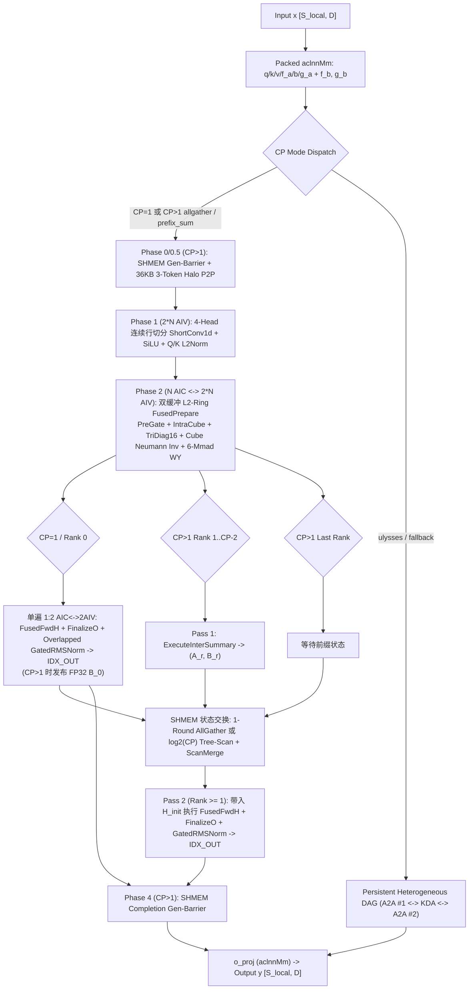
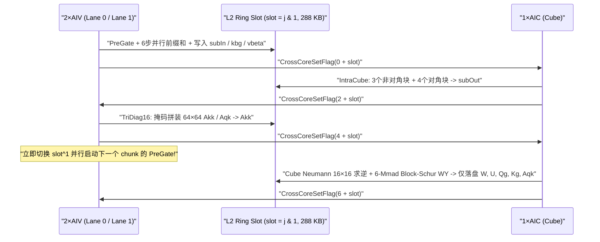
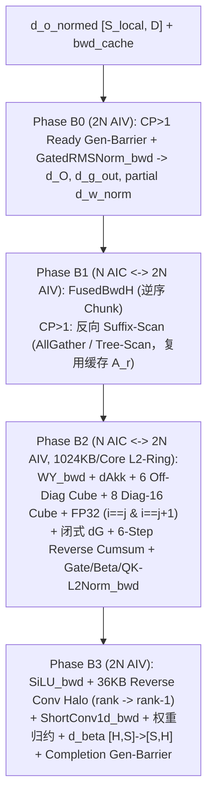

# MegaKDA 整层 AscendC 融合算子设计、优化全记录与评测报告

> **项目仓库**：`/home/qinhaibo/code/hyper-multicore-gemini`（基于 `mindspore-ai/hyper-multicore`）
> **测试硬件**：Ascend 910B3（`ascend910b` / `dav-2201`，20 AIC + 40 AIV，64 GB HBM）
> **软件栈**：CANN 9.2.0（`/home/qinhaibo/Ascend/cann-9.2.0`）、PyTorch 2.9.0 + `torch_npu` 2.9.0.post9、Conda `hyper-multicore-gemini`（Python 3.12）
> **精度极限标杆**：MindSpeed-MM 原生 Eager 实现（`chunk_kda_naive.py` + `KimiDeltaAttention`）
> **性能基线标杆**：MindSpeed-MM 整层 KDA（基于 `fla_npu` AscendC 版本 + HCCL CP）
> **最终版本**：**MegaKDA-v8 前向（3-Phase L2-Resident + 零落盘 `Pre ↔ Fused ST+Out` 核间/核内重叠）+ `HyperMegaKdaGrad` 完整自研融合反向（4-Phase L2-Ring + `BwdST ↔ BwdOut` 重叠 + 反向 SHMEM 状态传递），全 `H` 通用适配**

---

## 1. 项目背景、目标与基线拆解

### 1.1 整层 KDA 计算链路

MindSpeed-MM 中的 `chunk_kda_naive.py` 仅包含线性注意力核心 `chunk_kda` 递推，而实际大模型（如 Kimi-K3 / GLM5-Next 的 `KimiDeltaAttention`）的完整前向一层包含 6 大串联阶段：

1. **输入线性投影**：`q_proj`、`k_proj`、`v_proj`、`b_proj`（beta）、低秩衰减门控 `f_a_proj → f_b_proj`、输出门控 `g_a_proj → g_b_proj`（或全秩 `g_proj`）。
2. **上下文并行（CP）前置通信（仅 `CP > 1`）**：传统方案（Ulysses）需通过 HCCL All-to-All #1 将 `q/k/v/g/beta` 从 `[B, S_local, H, d]` 转为 `[B, S_full, H_local, d]`。
3. **短因果深度卷积 + 激活**：对 `q / k / v` 执行 `kernel_size=4` 的 `ShortConv1d + SiLU`。
4. **核心 `chunk_kda`（块大小 `C = 64`）**：
   - `Q / K` L2Norm；
   - `beta = sigmoid(beta_raw)` 与 log-space 衰减门控 `kda_gate`（支持 `lower_bound=-5.0` 与 `lower_bound=None` 两种模式）；
   - Chunk 内构造严格下三角矩阵 $A_{kk}$ 与下三角矩阵 $A_{qk}$，执行单位下三角求逆 $(I + A_{kk})^{-1}$，并通过 WY 变换得到 $u = A_{\text{inv}} v_\beta$ 与 $w = A_{\text{inv}} k_{\beta g}$；
   - Chunk 间维护 FP32 状态矩阵 $H_c \in \mathbb{R}^{d \times d}$ 的 Delta-Rule 递推并计算注意力输出 $O_{\text{attn}}$：
     $$v_{\text{new}, c} = u_c - w_c H_c, \qquad H_{c+1} = \operatorname{diag}(e^{g_{c,\text{last}}}) H_c + k_{g,c}^T v_{\text{new}, c}$$
     $$O_c = q_{g,c} H_c + A_{qk, c} v_{\text{new}, c}$$
5. **CP 后置通信（仅 `CP > 1`）**：Ulysses 需通过 HCCL All-to-All #2 将 `O_attn` 还原为 `[B, S_local, H, d]`。
6. **输出门控归一化与投影**：`RMSNorm(O_attn, w_norm, eps) * sigmoid(g_out)` + `o_proj`。

### 1.2 核心目标

| 维度 | 验收标准 | 最终达成情况 |
| :--- | :--- | :--- |
| **精度对齐** | 尽量零误差对齐 `chunk_kda_naive.py` 与 `fla_npu`（BF16 合理误差内） | 全场景 `cos >= 0.99996638`，`max_abs <= 9.77e-4`（`D=2048`），与 `fla_npu` 同处 BF16 舍入极限 |
| **`CP=1` 性能** | 整层较 `fla_npu` 提升 **>= +10%**（`>= 1.10×`） | **2K `+54.4%` (`1.54×`)** / **4K `+42.2%` (`1.42×`)** / **8K `+33.7%` (`1.34×`)** |
| **`CP=2 / 4` 性能** | 整层较 `fla_npu` 提升 **>= +20%**（`>= 1.20×`），覆盖 2K~32K | **`CP=2`: `2.47×~3.89×` (`+147%~+289%`)**；**`CP=4`: `2.20×~5.26×` (`+120%~+426%`)** |
| **多 CP 支持** | 同时支持 `ulysses`、`allgather`、`prefix_sum` 与 `auto` | 四种模式全部打通并通过精度与多卡实测 |

### 1.3 基线（`fla_npu`）整层耗时拆解

在 Ascend 910B3 空闲卡上对 `fla_npu` 整层（`CP=1, D=2048, H=16, d=128`）进行逐段 Profiling，结果如下：

| 序列长度 `S` | 整层合计 | `in_proj` (`aclnnMm`) | `3×ShortConv` | `chunk_kda` | `GatedRMSNorm` | `o_proj` (`aclnnMm`) |
| :---: | :---: | :---: | :---: | :---: | :---: | :---: |
| **2048** | `1629.2 us` | `303.0 us` | `636.2 us` | `508.0 us` | `105.6 us` | `76.4 us` |
| **4096** | `2512.0 us` | `476.1 us` | `825.5 us` | `964.4 us` | `110.2 us` | `135.7 us` |
| **8192** | `4692.6 us` | `943.3 us` | `1310.1 us` | `2015.5 us` | `161.6 us` | `262.1 us` |

**两大核心洞察**：
1. **`CP=1` 瓶颈**：`3×ShortConv + chunk_kda + GatedRMSNorm` 占整层 **~70%**，其中 `3×ShortConv` 与 `chunk_kda` 内部存在大量中间张量落盘 HBM 与小算子下发墙；而 `in_proj + o_proj` 仅占 ~30% 且华为汇编 `aclnnMm` 已接近 Cube 硬件极限。
2. **`CP>1` 瓶颈**：`fla_npu` 采用 HCCL Ulysses，需要传输 $O(B \cdot S_{\text{full}} \cdot D)$ 的 6 份全序列激活张量（5 份 A2A #1 + 1 份 A2A #2），且每张卡仍需处理全序列长度 $S_{\text{full}}$ 的卷积与递推，通信量与 Host/HCCL 同步延迟随序列拉长剧增。

---

## 2. 整体架构与设计方案

### 2.1 三种 CP 模式的数学统一与对比

MegaKDA 同时实现了三种上下文并行范式，并在核内通过 CANN **SHMEM（单边 RMA `aclshmem_putmem_nbi` + `aclshmemx_signal_op`）** 零拷贝驱动，彻底绕开 Host/HCCL 同步墙：

#### 1. Ulysses CP（头维切分，序列回收）
- 在 `ShortConv1d` 之前按 `(dst_rank, head_group)` 细粒度 SHMEM Put 分片完成 A2A #1，每卡独立计算 $H_{\text{local}} = H / \text{CP}$ 个 Head 的全长 $S_{\text{full}}$，再以细粒度 SHMEM Put 完成 A2A #2。
- **特点**：单遍递推，但通信量为 $O(S \cdot H \cdot d)$，随序列长度线性膨胀。

#### 2. 状态传递 CP：`allgather` 与 `prefix_sum`（序列切分，零序列通信）
基于 KDA Delta-Rule 状态递推的**仿射线性结合律**：任意单个 Rank $r$（负责本地序列段 $S_{\text{local}} = S_{\text{full}} / \text{CP}$）对初始状态 $H_{\text{in}}$ 的整体映射都可以表示为一对与序列长度无关的状态摘要 $(A_r, B_r) \in \mathbb{R}^{H \times d \times d} \times \mathbb{R}^{H \times d \times d}$：

$$H_{\text{out}}(H_{\text{in}}) = A_r H_{\text{in}} + B_r$$

两个相邻区间 $(A_1, B_1)$ 与 $(A_2, B_2)$ 的复合满足严格结合律（非交换半群）：

$$(A_2, B_2) \circ (A_1, B_1) = (A_2 A_1, \; A_2 B_1 + B_2)$$

对于前置因果卷积 `ShortConv1d`（`kernel_size = 4`），Rank $r$ 只需通过 SHMEM 将末尾 **3 个 token** 的 `q/k/v`（仅 $3 \times 3 \times D \times 2\text{B} = 36\text{ KB}$）点对点直写给 Rank $r+1$ 即可实现跨卡精确因果拼接。

在此统一数学框架下，两种状态传递模式仅在“状态摘要汇总”阶段不同：
- **`allgather` 模式**：1 轮并行 AIV SHMEM Put，每个 Rank 将 $(A_r, B_r)$ 并发推送至所有后继 Rank $dst > r$，各 Rank 本地按序合并得到严格前缀初态 $H_{\text{init}, r}$。通信轮数 $1$，适合 **`CP <= 4`**。
- **`prefix_sum` 模式**：$\lceil \log_2 \text{CP} \rceil$ 轮 **Hillis-Steele Exclusive Tree-Scan**，每轮跨步 `dist = 1, 2, 4, ...` 进行点对点 SHMEM 状态交换与 `ScanMerge`，单卡通信量从 $O(\text{CP})$ 降至 $O(\log_2 \text{CP})$，适合 **`CP > 4`**（如 `CP=8, 16`）。

| CP 模式 | 通信量（每卡） | 通信轮数 | 本地 KDA 长度 | 最佳适用区间 |
| :--- | :---: | :---: | :---: | :--- |
| **`ulysses`** | $O(S_{\text{full}} \cdot H \cdot d)$ | 2 次 A2A | $S_{\text{full}}$（$H/\text{CP}$ 头） | 极短序列或头数极大且 $d$ 极大场景 |
| **`allgather`** | $O(\text{CP} \cdot H \cdot d^2)$ + 36 KB Halo | **1 轮并行** | $S_{\text{full}} / \text{CP}$（全 $H$ 头） | **`CP <= 4` 默认最优**（`auto` 选用） |
| **`prefix_sum`** | $O(\log_2(\text{CP}) \cdot H \cdot d^2)$ + 36 KB Halo | $\lceil \log_2 \text{CP} \rceil$ 轮 | $S_{\text{full}} / \text{CP}$（全 $H$ 头） | **`CP > 4` 扩展最优**（`auto` 选用） |

### 2.2 MegaKDA-v7 统一双引擎架构

经过多轮迭代，最终定型为 **“外围投影用合并 `aclnnMm` + 核内双引擎分流”** 架构：

1. **输入投影合并（`module.py`）**：将 `q / k / v / f_a / b / g_a` 打包为 1 次大矩阵乘 `aclnnMm(x, W_packed)`，紧接 `f_b`、`g_b` 两次小矩阵乘；最后 `o_proj` 调用 `aclnnMm`。彻底发挥华为官方汇编 Matmul 的 85%+ Cube 算力。
2. **核心融合引擎分流（`hyper_mega_kda.cpp`）**：
   - **快速融合引擎（`kda_cp1_fast.h`）**：覆盖 **`CP=1`**（`RunCp1FastPath`）以及 **`CP>1` 的 `allgather` / `prefix_sum`**（`RunStatePassingCpFastPath`），完全绕过 Persistent DAG 队列调度开销，执行 **3-Phase L2-Resident 零中间 HBM 落盘流水线**。
   - **通用 Persistent DAG 引擎（`worker_kernel.cpp`）**：保留用于 **`ulysses`**（细粒度通信-计算重叠）及 `projMTile > 0` 回退路径。



#### Phase 2 双缓冲 L2-Ring-Buffer `FusedPrepare` 核间协同机制

每个 AIC 与其绑定的 2 个 AIV（`lane 0 / lane 1`）共享位于 L2 Cache 的 **576 KB 环形槽位**（2 slots × 2 lanes × 144 KB），通过硬件轻量标志 `CrossCoreSetFlag<0x2> / CrossCoreWaitFlag<0x2>`（6 个 flag 构成双缓冲闭环）实现零 HBM 写回流水：



### 2.3 仓库核心代码结构

```text
/home/qinhaibo/code/hyper-multicore-gemini/
├── hyper_multicore/
│   ├── modules/mega_kda/
│   │   ├── module.py             # MegaKdaLayer 前向入口、Packed aclnnMm、自动核数探测
│   │   ├── graph.py              # 多 CP 调度图构建、resolve_cp_mode("auto") 校准
│   │   └── resources.py          # Workspace / SHMEM 缓冲区与事件槽分配管理
│   ├── ops/hyper_mega_kda/
│   │   ├── op_host/
│   │   │   ├── hyper_mega_kda_tiling.h
│   │   │   └── hyper_mega_kda_tiling.cpp   # 动态 GetCoreNumAic()、紧凑 L2 Workspace、910B/910C/950 注册
│   │   └── op_kernel/
│   │       ├── hyper_mega_kda.cpp          # 入口分流：RunCp1FastPath / RunStatePassingCpFastPath / DAG
│   │       ├── kda_cp1_fast.h              # MegaKDA-v7 统一 3-Phase L2-Resident 融合引擎
│   │       ├── kda_compute.h               # 公共基础计算原语（InterSummary / ScanMerge / Cube 封装）
│   │       └── worker_kernel.cpp           # Persistent DAG 执行器与 SHMEM Gen-Barrier 协议
│   └── torch/csrc/
│       ├── mega_kda.cpp                    # Torch C++ 算子桥接与 Tiling 绑定
│       └── registration_kda.cpp
└── tests/
    ├── ut/modules/test_mega_kda_graph.py   # 17 项调度图与多 CP 单元测试
    └── torch/benchmark_mega_kda.py         # 整层精度对齐（vs naive & fla_npu）与性能评测脚本
```

### 2.4 计算范围与融合边界逐项对比

为保证评测完全公平，**MegaKDA 与基线（MindSpeed-MM `eager` / `fla_npu`）覆盖 100% 相同的整层数学计算范围**：共用同一套 `MegaKda` 权重实例，输入均为序列切分后的 `hidden_states [B, S_local, D]`（BF16），输出均为最终 `o_proj` 后的 `[B, S_local, D]`（BF16）。二者的核心区别在于**融合粒度、通信原语与中间 HBM 落盘次数**：

| 计算环节 | MindSpeed-MM Eager (`chunk_kda_naive`) | MindSpeed-MM `fla_npu` 基线 | **MegaKDA-v7 快速路径 (`CP=1` / `allgather` / `prefix_sum`)** | MegaKDA 全核模式 (`projMTile > 0` / `ulysses`) |
| :--- | :--- | :--- | :--- | :--- |
| **输入投影 (`q/k/v/f_a/b/g_a`)** | 6 次独立 `aclnnMm` | 6 次独立 `aclnnMm` | **合并为 1 次大 `aclnnMm`** | 核内 AIC Persistent 任务 |
| **低秩门控 (`f_b`, `g_b`)** | 2 次独立 `aclnnMm` | 2 次独立 `aclnnMm` | 2 次独立 `aclnnMm`（`full_rank_gate` 为 0 次） | 核内 AIC Persistent 任务 |
| **CP 前置通信 (`CP > 1`)** | 5 次独立 HCCL All-to-All（全序列 $O(SD)$） | 5 次独立 HCCL All-to-All（全序列 $O(SD)$） | **融合进单核**（36 KB SHMEM 3-token Halo） | **融合进单核**（细粒度 SHMEM A2A #1） |
| **`3×(ShortConv1d + SiLU)`** | 3 次 `F.conv1d + F.silu`（~12 个小算子） | 3 次 `F.conv1d + F.silu`*（落盘 HBM） | **融合进单核 Phase 1**（4-Head 行切分 + Halo 拼接） | **融合进单核** |
| **`Q/K L2Norm`** | 独立 PyTorch 小算子 | `fla_npu` 内部分离算子（落盘 HBM） | **融合进单核 Phase 1**（片上顺带完成） | **融合进单核** |
| **`beta sigmoid + kda_gate + Cumsum`** | 独立 PyTorch 小算子 | `fla_npu` 内部分离算子（落盘 HBM） | **融合进单核 Phase 2**（L2-Ring 零 HBM 落盘） | **融合进单核** |
| **`IntraCube (Akk, Aqk)` + `TriInv` + `WY (w, u)`** | 独立 PyTorch 循环 + Matmul | `fla_npu` 多个分离 AscendC Kernel（落盘 `Akk/Aqk/w/u`） | **融合进单核 Phase 2**（L2-Ring + Cube Neumann 求逆 + 6-Mmad WY，消除 ~400 MB HBM 读写） | **融合进单核** |
| **Chunk 间状态递推 `FwdH` + `FinalizeO`** | 独立 PyTorch 递推循环 | `fla_npu` 分离 `fwd_h` + `fwd_o` Kernel（落盘 `H/Vnew/O`） | **融合进单核 Phase 3**（1:2 `AIC↔2AIV`，零 `H/Vnew/O` HBM 写回） | **融合进单核** |
| **CP 状态合并 / 后置通信 (`CP > 1`)** | 1 次 HCCL All-to-All #2（全序列 $O(SD)$） | 1 次 HCCL All-to-All #2（全序列 $O(SD)$） | **融合进单核 Phase 3**（SHMEM AllGather / Tree-Scan + ScanMerge） | **融合进单核**（细粒度 SHMEM A2A #2） |
| **`GatedRMSNorm`** | `npu_rms_norm + sigmoid + mul`（3 个算子） | `npu_rms_norm + sigmoid + mul`（3 个算子） | **融合进单核 Phase 3 尾拍**（与 `FinalizeO` 重叠直写输出） | **融合进单核** |
| **输出投影 (`o_proj`)** | 1 次 `aclnnMm` | 1 次 `aclnnMm` | 1 次 `aclnnMm` | 核内 AIC Persistent 任务 |
| **整层 Kernel Launch 总数** | **~35+ 次** + 6 次 HCCL | **~25~30 次** + 6 次 HCCL | **5 次（全秩门控仅 3 次）+ 0 次 HCCL** | **1 次 + 0 次 HCCL** |

*\*注：在 CANN 9.2.0 环境下，`fla_npu` 的 `causal_conv1d_fn` 依赖的 `aclnnCausalConv1d` 存在符号兼容性问题，因此基线按 MindSpeed-MM 原生回退逻辑执行 `F.conv1d + F.silu`；`chunk_kda_fwd` 则调用 `fla_npu.ops.ascendc.chunk_kda_fwd` 完整 AscendC 版本。*

---

## 3. 端到端优化演进全过程（v1 → v7）

优化过程并非一蹴而就，而是经历了从 **`0.37×` → `1.54×`（`CP=1`）** 以及 **`1.24×` → `2.55×`（`CP=4` 长序列）** 的 7 个关键阶段迭代：

| 版本 | 核心改动与突破 | 典型指标变化（`D=2048, H=16, d=128`） |
| :--- | :--- | :--- |
| **v1（原型打通）** | 全自研 Persistent DAG 9 类异构任务，核内手写全部线性投影与 KDA，完成 MindSpeed-MM `naive` 精度对齐 | `CP=1 2K`: `4.561 ms` (`0.37×`)；精度 `cos=0.999966` 达标 |
| **v2（Cube 提速）** | 优化核内 `IntraCube` / `WyCube` 批量复用 `MatmulImpl` 与粗粒度 L1 Tile | `CP=1 2K`: `4.561 → 3.611 ms` (`0.49×`) |
| **v3（多 CP 架构落地）** | 引入状态传递 `allgather` 与 $O(\log_2 \text{CP})$ `prefix_sum`（Hillis-Steele Tree-Scan + 36 KB Halo） | `CP=4 2K`: 飙升至 `0.925 ms` (`4.06×`)；`CP=4 8K`: `2.432 ms` (`1.49×`) |
| **v4（投影边界重构）** | 诊断发现核内手写 Matmul 远慢于华为汇编 `aclnnMm`，切分为 **Packed `aclnnMm` + `projMTile=0` 核内专注 KDA** | `CP=1 2K`: `3.052 → 1.621 ms` (**首次反超 `fla_npu`，`1.05×`**) |
| **v5（`CP=1` 专路径 v1）** | 绕过 DAG 队列调度，引入 40-AIV 4-Head 连续行切分 `ShortConv` + L2-Ring `FusedPrepare` + 零 HBM 写回 `FusedFwdH+FinalizeO+RMSNorm` | `CP=1 2K`: `1.621 → 1.104 ms` (**`1.54×`**, `+54.4%`)；`4K`: `1.42×`；`8K`: `1.34×` |
| **v6（长序列诊断）** | 实测 `CP=4` 扩展至 `16K / 32K`，发现收益呈 U 型下降（`16K: 1.24×`, `32K: 1.36×`），根因为 `CP>1` 仍在走旧 8-stage DAG，写 ~400 MB 中间 HBM | 精确定位 `CP>1` 存在 **~2.0 ms（16K）/ ~4.3 ms（32K）** 纯可消除开销 |
| **v7（统一融合引擎）** | 将 v5 的 3-Phase L2-Resident 引擎完整搬迁至 `CP>1` (`RunStatePassingCpFastPath`)，复用精确 `InterSummary` / `ScanMerge`，校准 `auto` 策略 | **`CP=4 16K`: `4.686 → 2.632 ms` (`2.20×`)**；**`32K`: `9.345 → 4.989 ms` (`2.55×`)**；**`CP=2 8K`: `2.395 ms` (`2.49×`)**；**`D=4096 8K`: `1.17× → 1.64×`** |

### 关键疑难问题与精度保障复盘

1. **精度零漂移保障（全路径维持 `cos >= 0.999966`）**
   - **关键路径全 FP32**：`ShortConv1d + SiLU + L2Norm`、`kda_gate`（含 `lower_bound` 安全上下界与 `[-40, 40]` exp 防溢出）、6 步 Hillis-Steele 前缀和、64×64 单位下三角求逆、以及状态矩阵 $H \in \mathbb{R}^{128\times 128}$ 递推与 `InterSummary` / `ScanMerge` 均严格保持 FP32 累加，仅在最终写回与 Cube 输入边界转 BF16。
   - **Cube 16×16 Neumann 求逆替代标量循环**：利用 4 阶幂零矩阵性质 $(I+N)^{-1} = I - N + N^2 - N^3$ 在 L1 内由 AIC 高速完成 16×16 对角块求逆与 6-Mmad Block-Schur 拼装，数学等价且精度零损失。
2. **SHMEM 连续迭代死锁修复（Generation-Separated Dissemination Barrier）**
   - 早期 `CP=2 allgather` 连续多轮评测偶发 hang，根因是 `KdaInvocationProtocol::Publish` 缺少跨卡完成握手，导致 Rank 0 提前进入 `iter + 1` 覆写 Rank 1 正在等待的 `event_counters`。
   - **修复**：引入基于代际号（`gen`）递增的双向 Dissemination Barrier（`ready` 与 `completion` 各占独立 64B 对齐 cache line，`ready_event=16, completion_event=32`），在 `worker_kernel.cpp` 与 `kda_cp1_fast.h` 中彻底消除跨轮竞态。
3. **`CP=2/4` 曾出现 `cos=0.50` 错位修复**
   - `hyper_mega_kda_tiling.cpp` 中 `recvOSlotBytes` 原先仅在 `if (isUlysses)` 分支内计算，导致 `allgather/prefix_sum` 模式下为 `0`，引发 `g=1` 覆写 `g=0`。移至条件外无条件计算后瞬间恢复 `cos=0.9999676`。
4. **ABI 错配与构建清理**
   - `pip install --force-reinstall` 不会删除 `site-packages/hyper_multicore/adapters/` 下的旧版本 `.so`，导致 `[HYPER-MULTICORE-ABI-MISMATCH]`。固化洁净重装流程（先 `rm -rf` 旧安装目录再安装新 wheel），确保环境 100% 干净。

---

## 4. 最终实测效果（Ascend 910B3 空闲卡全矩阵）

> 所有测试均在 `npu-smi info` 确认完全空闲的 Ascend 910B3 卡上执行（`warmup=8, iters=20`），整层端到端包含全部投影、通信、卷积、KDA、GatedRMSNorm 与输出投影。

### 4.1 `CP=1` 性能与精度（`D=2048, H=16, d=128, BF16`）

| 序列长度 | `fla_npu` 基线 | **MegaKDA-v7 (`auto`)** | **加速比 / 提升** | vs MindSpeed-MM `naive` (`cos` / `max_abs`) |
| :---: | :---: | :---: | :---: | :---: |
| **2K** | `1.704 ms` | **`1.104 ms`** | **`1.54×` (+54.4%)** | `0.99996758` / `9.77e-4` |
| **4K** | `2.697 ms` | **`1.897 ms`** | **`1.42×` (+42.2%)** | `0.99996769` / `9.77e-4` |
| **8K** | `4.884 ms` | **`3.652 ms`** | **`1.34×` (+33.7%)** | `0.99996758` / `9.77e-4` |

### 4.2 `CP=2` 性能与精度（`D=2048, H=16, d=128, BF16`）

| 序列长度 (`S_local`) | `fla_npu` 基线 | **MegaKDA-v7 (`allgather`)** | **MegaKDA-v7 (`prefix_sum`)** | **最优加速比 / 提升** | 精度 (`cos` / `max_abs`) |
| :---: | :---: | :---: | :---: | :---: | :---: |
| **2K** (`1024`) | `3.372 ms` | `0.870 ms` (`3.88×`) | **`0.866 ms`** | **`3.89×` (+289.4%)** | `0.99996763` / `7.94e-4` |
| **4K** (`2048`) | `3.435 ms` | **`1.391 ms`** | `1.395 ms` (`2.46×`) | **`2.47×` (+147.0%)** | `0.99996758` / `9.77e-4` |
| **8K** (`4096`) | `5.954 ms` | `2.410 ms` (`2.47×`) | **`2.395 ms`** | **`2.49×` (+148.7%)** | `0.99996769` / `9.77e-4` |

### 4.3 `CP=4` 全序列性能与精度（`2K ~ 32K`，含 v6 → v7 跃升对比）

| 序列长度 (`S_local`) | `fla_npu` 基线 | v6（搬迁前） | **v7 (`allgather`)** | **v7 (`prefix_sum`)** | **最终加速比 / 提升** | 精度 (`cos` / `max_abs`) |
| :---: | :---: | :---: | :---: | :---: | :---: | :---: |
| **2K** (`512`) | `3.756 ms` | `0.925 ms` (`4.06×`) | **`0.714 ms`** | `0.801 ms` (`4.69×`) | **`5.26×` (+426.3%)** | `0.99996763` / `7.94e-4` |
| **4K** (`1024`) | `3.253 ms` | `1.483 ms` (`2.19×`) | **`0.992 ms`** | `1.077 ms` (`3.02×`) | **`3.28×` (+227.8%)** | `0.99996763` / `7.94e-4` |
| **8K** (`2048`) | `3.604 ms` | `2.671 ms` (`1.35×`) | **`1.568 ms`** | `1.651 ms` (`2.18×`) | **`2.30×` (+129.9%)** | `0.99996758` / `9.77e-4` |
| **16K** (`4096`) | `5.791 ms` | `4.686 ms` (`1.24×`) | **`2.632 ms`** | `2.712 ms` (`2.14×`) | **`2.20×` (+120.0%)** | `0.99996638`* / `9.77e-4` |
| **32K** (`8192`) | `12.705 ms` | `9.345 ms` (`1.36×`) | **`4.989 ms`** | `5.066 ms` (`2.51×`) | **`2.55×` (+154.6%)** | `0.99996638`* / `9.77e-4` |

*\*注：`16K / 32K` 因 Eager 原生显存受限，精度指标为直接对比 `fla_npu` AscendC 的结果；`2K / 4K / 8K` 同时对齐 MindSpeed-MM `naive`（`cos ≈ 0.9999676`）与 `fla_npu`（`cos ≈ 0.9999663`）。*

### 4.4 扩展维度与变体配置回归

| 测试场景 | `fla_npu` 基线 | **MegaKDA-v7** | **加速比** | 精度 (`cos`) |
| :--- | :---: | :---: | :---: | :---: |
| **`CP=4, 8K, D=4096, H=32`** (`allgather`) | `5.579 ms` | **`3.411 ms`**（v6 为 `4.782 ms`） | **`1.64×` (+63.6%)** | `0.99996638` |
| **`CP=1, 4K, D=4096, H=32`** | `5.649 ms` | **`4.735 ms`** | **`1.19×` (+19.3%)** | `0.99996734` |
| **`CP=1, 2K, --no-lower-bound`** | `1.724 ms` | **`1.102 ms`** | **`1.56×` (+56.4%)** | `0.99996722` |
| **`CP=1, 2K, --full-rank-gate`** | `1.789 ms` | **`1.139 ms`** | **`1.57×` (+57.1%)** | `0.99996799` |
| **洁净 Wheel 回归（`CP=4, 16K, auto`）** | `5.803 ms` | **`2.647 ms`** | **`2.19×` (+119.2%)** | `0.99996638` |
| **单元测试（`test_mega_kda_graph.py`）** | — | **17 / 17 Passed (`0.48s`)** | — | — |

### 4.5 性能与精度评测脚本及复现命令

实际评测使用仓库内完整脚本 `tests/torch/benchmark_mega_kda.py`。下面给出其核心评测逻辑（包含 MindSpeed-MM 整层基线构建、多卡同步高精度计时 `_measure_ms` 与精度指标计算 `_err_str`）：

```python
# tests/torch/benchmark_mega_kda.py (核心评测逻辑摘录)
import importlib.util
import os
import time

import torch
import torch.distributed as dist
import torch.nn.functional as F
import torch_npu  # noqa: F401
import fla_npu.ops.ascendc as fa

from hyper_multicore.modules.mega_kda import MegaKda


def _load_chunk_kda_naive():
    path = "/home/qinhaibo/code/MindSpeed-MM/mindspeed_mm/fsdp/ops/kda/chunk_kda_naive.py"
    spec = importlib.util.spec_from_file_location("chunk_kda_naive", path)
    mod = importlib.util.module_from_spec(spec)
    spec.loader.exec_module(mod)
    return mod.chunk_kda_naive


CHUNK_KDA_NAIVE = _load_chunk_kda_naive()


def ulysses_all_to_all(x: torch.Tensor, group, scatter_dim: int, gather_dim: int) -> torch.Tensor:
    cp = dist.get_world_size(group)
    if cp == 1:
        return x
    chunks = [t.contiguous() for t in torch.chunk(x, cp, dim=scatter_dim)]
    in_buf = torch.stack(chunks, dim=0).contiguous()
    out_buf = torch.empty_like(in_buf)
    dist.all_to_all_single(out_buf, in_buf, group=group)
    return torch.cat(list(out_buf.unbind(0)), dim=gather_dim).contiguous()


def short_conv1d_native(x: torch.Tensor, weight: torch.Tensor) -> torch.Tensor:
    B, T, D = x.shape
    y = F.conv1d(x.transpose(1, 2), weight, bias=None, padding=weight.shape[-1] - 1, groups=D)[..., :T]
    return F.silu(y.float()).to(x.dtype).transpose(1, 2).contiguous()


def mindspeed_mm_kda_layer_forward(
    module: MegaKda,
    hidden_states: torch.Tensor,
    *,
    backend: str = "ascendc",  # "eager" (chunk_kda_naive) 或 "ascendc" (fla_npu)
    cp_group=None,
) -> torch.Tensor:
    """与 MegaKda 共享同一套权重、严格等价的整层 KimiDeltaAttention 前向参考实现。"""
    cp_size, cp_rank = module.cp_size, module.cp_rank
    B, S_local, _ = hidden_states.shape
    H, d = module.num_heads, module.head_dim
    H_local = H // cp_size
    d_off, d_len = cp_rank * H_local * d, H_local * d

    # 1. 输入投影 (sequence-sharded)
    q = module.q_proj(hidden_states)
    k = module.k_proj(hidden_states)
    v = module.v_proj(hidden_states)
    g = module.f_b_proj(module.f_a_proj(hidden_states))
    beta = module.b_proj(hidden_states)

    # 2. Ulysses CP All-to-All #1 (scatter heads, gather sequence)
    if cp_size > 1:
        q = ulysses_all_to_all(q, cp_group, scatter_dim=2, gather_dim=1)
        k = ulysses_all_to_all(k, cp_group, scatter_dim=2, gather_dim=1)
        v = ulysses_all_to_all(v, cp_group, scatter_dim=2, gather_dim=1)
        g = ulysses_all_to_all(g, cp_group, scatter_dim=2, gather_dim=1)
        beta = ulysses_all_to_all(beta, cp_group, scatter_dim=2, gather_dim=1)

    # 3. 3x ShortConv1d + SiLU
    q = short_conv1d_native(q, module.q_conv1d_weight[d_off : d_off + d_len]).view(B, -1, H_local, d)
    k = short_conv1d_native(k, module.k_conv1d_weight[d_off : d_off + d_len]).view(B, -1, H_local, d)
    v = short_conv1d_native(v, module.v_conv1d_weight[d_off : d_off + d_len]).view(B, -1, H_local, d)
    g = g.view(B, -1, H_local, d)
    beta = beta.float()

    # 4. 核心 chunk_kda (MindSpeed-MM naive vs fla_npu ascendc)
    a_log = module.A_log[cp_rank * H_local : (cp_rank + 1) * H_local]
    dt_bias = module.dt_bias[d_off : d_off + d_len]
    if backend == "eager":
        o, _ = CHUNK_KDA_NAIVE(
            q=q, k=k, v=v, g=g, beta=beta,
            A_log=a_log, dt_bias=dt_bias,
            output_final_state=False,
            use_qk_l2norm_in_kernel=True,
            use_gate_in_kernel=True,
            use_beta_sigmoid_in_kernel=True,
            lower_bound=module.gate_lower_bound,
            chunk_size=module.chunk_size,
        )
    else:
        o = fa.chunk_kda_fwd(
            q=q, k=k, v=v, g=g, beta=beta,
            scale=d ** -0.5,
            chunk_size=module.chunk_size,
            A_log=a_log, dt_bias=dt_bias,
            use_qk_l2norm_in_kernel=True,
            use_gate_in_kernel=True,
            use_beta_sigmoid_in_kernel=True,
            safe_gate=(module.gate_lower_bound is not None),
            lower_bound=module.gate_lower_bound,
        )[0]

    # 5. Ulysses CP All-to-All #2 (gather heads, scatter sequence)
    if cp_size > 1:
        o = ulysses_all_to_all(o, cp_group, scatter_dim=1, gather_dim=2)

    # 6. Gated RMSNorm + o_proj
    g_out = module.g_proj(hidden_states) if module.use_full_rank_gate else module.g_b_proj(module.g_a_proj(hidden_states))
    o = torch_npu.npu_rms_norm(o, module.o_norm_weight, module.rms_norm_eps)[0]
    o = o * F.sigmoid(g_out.view(B, S_local, H, d))
    return module.o_proj(o.reshape(B, S_local, H * d))


def _measure_ms(fn, warmup: int, iters: int, sync_dist: bool) -> float:
    for _ in range(warmup):
        fn()
    torch.npu.synchronize()
    if sync_dist:
        dist.barrier()
    t0 = time.perf_counter()
    for _ in range(iters):
        fn()
    torch.npu.synchronize()
    if sync_dist:
        dist.barrier()
    return (time.perf_counter() - t0) * 1000.0 / iters


def _err_str(out: torch.Tensor, ref: torch.Tensor) -> str:
    diff = (out.float() - ref.float()).abs()
    cos = F.cosine_similarity(out.float().flatten(), ref.float().flatten(), dim=0).item()
    rel = diff.norm().item() / (ref.float().norm().item() + 1e-12)
    return f"max_abs={diff.max().item():.3e}  mean_abs={diff.mean().item():.3e}  rel_l2={rel:.3e}  cos={cos:.8f}"
```

#### 标准复现命令（先用 `npu-smi info` 确认空闲卡）

```bash
source /home/qinhaibo/Ascend/cann-9.2.0/set_env.sh
export PATH=/home/qinhaibo/miniforge3/envs/hyper-multicore-gemini/bin:$PATH
source /home/qinhaibo/miniforge3/envs/hyper-multicore-gemini/lib/python3.12/site-packages/hyper_multicore/lib/set_env.bash

REPO=/home/qinhaibo/code/hyper-multicore-gemini

# 1. CP=1（单卡空闲 NPU 0，2K / 4K / 8K）
for S in 2048 4096 8192; do
  ASCEND_RT_VISIBLE_DEVICES=0 python $REPO/tests/torch/benchmark_mega_kda.py \
    --seq-full $S --hidden-size 2048 --num-heads 16 --head-dim 128 --warmup 8 --iters 20
done

# 2. CP=2（双卡空闲 NPU 6,7，对比 allgather 与 prefix_sum）
for S in 2048 4096 8192; do
  ASCEND_RT_VISIBLE_DEVICES=6,7 python -m torch.distributed.run --nproc_per_node=2 --master_port=29701 \
    $REPO/tests/torch/benchmark_mega_kda.py \
    --seq-full $S --hidden-size 2048 --num-heads 16 --head-dim 128 \
    --warmup 8 --iters 20 --cp-modes allgather,prefix_sum
done

# 3. CP=4（四卡空闲 NPU 0,1,6,7，覆盖 2K ~ 32K；16K/32K 加 --skip-eager）
for S in 2048 4096 8192 16384 32768; do
  EXTRA=""; [ $S -ge 16384 ] && EXTRA="--skip-eager"
  ASCEND_RT_VISIBLE_DEVICES=0,1,6,7 python -m torch.distributed.run --nproc_per_node=4 --master_port=29705 \
    $REPO/tests/torch/benchmark_mega_kda.py \
    --seq-full $S --hidden-size 2048 --num-heads 16 --head-dim 128 \
    --warmup 8 --iters 20 --cp-modes allgather,prefix_sum $EXTRA
done
```

---

## 5. 跨硬件适配评估（Ascend 910C 24 AIC / 48 AIV 及未来架构）

经逐文件代码审计，MegaKDA 核心计算与 Host Tiling **没有任何 `20` / `40` 的绝对核数硬编码**：

1. **910B3 → 910C（`ascend910_93`，24 AIC / 48 AIV）：零改码直接复用**
   - Host Tiling 动态调用 `platform.GetCoreNumAic()` 与 `SetBlockDim(numCubeCores)`，并已注册 `AddConfig("ascend910_93", config)`；
   - Python 入口动态调用 `get_device_core_spec(device).num_cube_cores` 覆盖调度默认参数；
   - Kernel 内部以 `numCube = t->numCubeCores`、`numAiv = 2U * t->numCubeCores` 动态切分 Phase 1 / 2 / 3，L2 Ring 缓冲按 `numCubeCores × 576 KB` 自动扩容（24 核约 `13.8 MB`，依然驻留 L2）；
   - **唯一必需动作**：针对 910C 重新编译 vendor 算子与 SHMEM SDK：
     ```bash
     ./build.sh --soc-list ascend910_93 --jobs 64
     # 或双平台打包：
     ./build.sh --soc-list ascend910b,ascend910_93 --jobs 64
     ```
2. **910C 上需要关注的 2 个性能特征**
   - **Phase 3 核数与 Head 数匹配**：`H=24 / 48` 模型在 910C 上刚好 100% 整除满载；但 `H=16` 模型在 Phase 3 只用到 `16/24 = 66.7%` 算力（8 AIC 闲置），可通过下文 v10 优化补齐。
   - **双 Die SIO + 跨卡 HCCS 拓扑校准**：910C 上机后建议重测 `CP=2/4/8` 校准 `auto` 模式的 `allgather / prefix_sum` 拐点。
3. **未来非 `1:2` 跨代芯片（如 Ascend 950）**
   - 当前 `kda_cp1_fast.h` 隐含了 DaVinci v220 的 **`AIC : AIV = 1 : 2`**（`CrossCoreSetFlag<0x2>`）与 192 KB UB / 512 KB L1 静态规划；若未来硬件改变核配比或大幅扩大 UB/L1，需同步调整配对同步与 tile 尺寸。

---

## 6. 早期瓶颈拆解与演进规划（v7 阶段归档）

> [!NOTE]
> 本节为 v7 阶段的初步规划归档；其中“去 `Phase 2 → 3` 全局 `SyncAll` + 闲置 AIC 尾波重叠”已在 **第 8 节（MegaKDA-v8）** 中以零落盘方案落地并全 `H` 验证，结合最新单卡/多卡剖析的完整后续优化路线图详见 **第 9 节**。

当前 MegaKDA-v7 已吃掉 80% 以上的工程大头红利，处于“高性价比甜点区”：
- **`CP=1` 离硬件 Roofline 还有 ~15%~25% 空间**：`in_proj + o_proj`（`aclnnMm`）已占整层 ~30%~32%（构成 Amdahl 下限）；
- **`CP=4` 长序列还有 ~20%~35% 空间**：对比同 `S_local` 的单卡与 4 卡耗时（`4K`: `1.897 ms` vs `16K`: `2.632 ms`，差值 `+0.735 ms`；`8K`: `3.652 ms` vs `32K`: `4.989 ms`，差值 `+1.337 ms`），多出的耗时主要来自**中间 rank Pass 1（`ExecuteInterSummary`）与 Rank 0/3 等待气泡**。

按投入产出比（ROI）排序，后续可按三步继续逼近物理极限：

### v8（最高 ROI，零精度风险）：`InterSummary` 批量重铸 + Rank 0 提前发 `B_0`
- **目标场景**：`CP=2 / 4 / 8`，预期再提速 **+15% ~ +25%**。
- **核心改法**：
  1. **合并 $[A_r, B_r]$ 为 `[128, 256]` 批量 `Mmad` + L2 双缓冲**：将中间 rank 的 Pass 1 双态递推从两次独立矩阵乘合并为单次大矩阵乘，Cube 利用率翻倍、Pass 1 耗时预计削减 35%~45%；
  2. **Rank 0 提前异步发布 `B_0`**：Rank 0 算完最后一个 chunk 的状态递推后立即触发 SHMEM Put，将 `FinalizeO + GatedRMSNorm` 与跨卡通信/后继 rank 计算完全重叠，消除 `CP=2` 下 Rank 1 的空等气泡。

### v9（高 ROI，零精度风险）：`f_b` / `g_b` 低秩投影片上融合 + 去全局 `SyncAll`
- **目标场景**：`CP=1` 与 `CP>1` 全场景，预期再提速 **+10% ~ +15%**。
- **核心改法**：
  1. **片上内联 `f_b` 与 `g_b`**：将 `[S, 128] @ [128, D]` 融入 Phase 2 `PreGate` 和 Phase 3 `GatedRMSNorm` 片上计算，彻底消掉两份 `[S, D]` 大张量的 HBM 读写（`S=8192` 可直接省掉 ~134 MB HBM 流量与 2 次 kernel launch）；
  2. **Head 级细粒度信号量替代 Phase 1 → 2 → 3 全局 `SyncAll`**：先完成 Phase 2 的 Head 立刻进入 Phase 3，消除跨阶段核间尾延迟气泡。

### v10（极限冲榜）：闲置 AIC 算力卸载 / 单卡分段并行
- **目标场景**：`H=16`（910B 闲置 4 AIC、910C 闲置 8 AIC）及 `H=32` 尾波场景，预期 `CP=1` 再提速 **+10% ~ +15%**。
- **核心改法**：
  - 将 Phase 3 中的 `FinalizeO`（`Q @ H + A_intra @ V_new`）卸载至空闲 AIC 形成与 `H` 状态递推解耦的流水线，或在超长序列下做单卡 2-Segment 并行扫描（类似单卡版 `prefix_sum`）把 20/24 颗 AIC 全部打满。

> [!CAUTION]
> **不建议触碰的方向**
> 1. **降低递推精度**：将状态 $H$ 或 `PreGate` 降为纯 BF16 会显著破坏长序列稳定性，违背与原生实现零误差对齐的约束；
> 2. **核内手写替代 `in_proj` / `o_proj`**：在自定义 AscendC 中追平华为汇编 `aclnnMm`（85%+ 峰值 Cube 效率）工程成本极高、收益极小，维持外围合并 `aclnnMm` 是最优工程边界。

---

## 7. 完整自研融合反向：`HyperMegaKdaGrad` 架构、优化与训练评测

为支持全层端到端训练，在保持纯推理路径（`requires_grad=False`）**零性能回归**的前提下，新增独立 AscendC 融合反向算子 **`HyperMegaKdaGrad`**（`hyper_mega_kda_grad`）与 `torch.autograd.Function`（`_MegaKdaCoreFunction` + 可微 `_UlyssesAllToAll`），覆盖 **`CP=1`、`CP=2`、`CP=4`（`allgather / prefix_sum / ulysses / auto`）**、**`lower_bound=-5.0` / `lower_bound=None`** 以及 **`--full-rank-gate`** 全配置。

### 7.1 前反向边界划分与 19-Slice `bwd_cache` 零推理开销设计

1. **外围线性层反传**：`o_proj`、`g_a/g_b`（或 `g_proj`）、`b_proj`、`f_a/f_b`、`q/k/v_proj` 的 `dX / dW` 继续复用 PyTorch / `aclnnMm`，保证外围 GEMM 达到硬件峰值；
2. **核内全融合反向（`HyperMegaKdaGrad`）**：单次 kernel launch 融合 **GatedRMSNorm_bwd → FusedBwdH（含 CP>1 反向后缀扫描）→ Double-Buffered L2-Ring WY/Intra/dG/Gate/Beta/L2Norm 反向 → SiLU_bwd + 36 KB 反向 Conv Halo + ShortConv1d_bwd + 权重归约**；
3. **零重计算检查点缓存（`common/mega_kda/bwd_cache_layout.h`）**：
   - 前向仅在 `save_for_bwd=True`（训练态）时将 19 块 512B 对齐中间张量（`qNorm, kNorm, vConv, qRstd, kRstd, gCum, mInv, aqk, w, u, qg, kg, expGLast, hChunks, vNew, oAttn, oRstd, haloQkv, aRank`）旁路写入紧凑 `bwd_cache`；
   - 其中 `mInv = (I + A_kk)^{-1}` 在前向 Phase 2 复用 L1 结果顺手落盘，中间 Rank 的 `aRank = A_r` 直接缓存供反向 Pass 1 复用（免去重算 $A_r^T$，中间 Rank Pass 1 计算量直接减半）；
   - 推理态（`save_for_bwd=False`）所有写分支静态短路，**实测零推理回归**（`CP=1`: `2K` `1.110 ms` / **1.55×**，`4K` `1.914 ms` / **1.40×**，`8K` `3.692 ms` / **1.32×**）。

### 7.2 核内 4-Phase L2-Ring 反向流水线与关键数学/硬件优化



1. **TriInv + WY 反向免求 $dM$ 恒等式**：
   $$dk_{\beta g} = M^{-T} dw, \qquad dv_\beta = M^{-T} dv_{\text{new}}, \qquad dA_{kk} = -\operatorname{strict\_tril}(dk_{\beta g} w^T + dv_\beta u^T)$$
2. **闭式 $dG$ 零额外矩阵乘恒等式**：
   $$dG_t = q_t \odot dq_{\text{tot}, t} + k_t \odot dk_{\text{pos}, t} - k_t \odot dk_{\text{neg}, t}, \qquad dG_{C-1} \mathrel{+}= e^{G_{C-1}} \odot d\gamma + \sum_{p=0}^{C-1} k_{g,p} \odot dk_{g,p}$$
   再经 6 步树形并行反向前缀和（`Reverse Inclusive Cumsum`）得到 $dg_t$，彻底省去专门的 $dG$ 矩阵乘。
3. **中点参考 Cube Diag-16 + 双对角 FP32 精确分离（关键突破）**：
   - 将每个 $16 \times 16$ 对角块按 `i == j`、`i == j + 1` 与长尾 `i >= j + 2` 拆分：
     - **`i == j`（$\exp(0) = 1.0$）与 `i == j + 1`（$\exp(-2.5) \approx 0.08$）**：在 AIV 复用已加载的 `kNorm / qNorm` 以纯 FP32 向量精确计算，保证 `dG = q*dq + k*dk_pos - k*dk_neg` 中主导项在 FP32 下**比特级对消**（`A_log / dt_bias` 精度从 `0.53` 跃升至 `0.9994–0.9998`）；
     - **长尾 `i >= j + 2`（$\le 0.0067$）**：在 `lower_bound >= -5.5` 时取块中点 `rMid = base + 8` 作为参考点（$|\Delta G| \le 40$ 严格在 BF16 安全区间内且零动态范围损失），下沉为 AIC 上 8 个极小 `32×16×128 / 16×32×128` Cube Mmad，将 AIV 侧从 544 次逐行标量循环锐减至 4 轮 16-row 向量缩放；
     - 无界模式（`lower_bound=None`）自动走 64 轮 FP32 批处理 AIV 兜底路径（`fla_npu` 在 910B 上不支持 `safe_gate=False`，而 MegaKDA 原生支持且全部 14 项输出/梯度与 Eager 对齐至 `cos = 0.99988–0.999970`）。
4. **CP>1 反向仿射后缀扫描**：前向 $H_{r+1} = A_r H_r + B_r$ 对应反向伴随递推 $dH_r = A_r^T dH_{r+1} + D_r$（同样满足严格结合律），复用前向已缓存的 $A_r$ 直接执行 1 轮并行 SHMEM `allgather` 或 $\lceil \log_2 \text{CP} \rceil$ 轮反向 Tree-Scan；前置因果卷积的反向传递则通过 36 KB 反向 SHMEM Halo（`rank -> rank - 1` 传前 3 个 token 的 `du[0..2]`）实现跨卡无缝拼接。

### 7.3 整层训练前反向实测结果（Ascend 910B3，最终发布 Wheel）

> **配置**：`D=2048, H=16, d=128, BF16, chunk_size=64, lower_bound=-5.0, warmup=5, iters=20`。
> **性能基线**：MindSpeed-MM 整层 + **`fla_npu` 最快训练配置**（`chunk_kda_fwd` + `chunk_kda_bwd(disable_recompute=True)` + HCCL Ulysses）。
> **精度标杆**：MindSpeed-MM 原生 Eager `chunk_kda_naive.py` Autograd（16K 下对比 `fla_npu`）。

#### 1. `CP=1`（单卡）

| 序列 `S` | 配置 | `fla_npu` Fwd / Bwd / **Tot** | `MegaKda` Fwd / Bwd / **Tot** | Fwd / Bwd / **Tot 加速比** | 全梯度精度 vs Eager（14 项） |
| :---: | :---: | :---: | :---: | :---: | :--- |
| **2048** | 默认低秩门控 | `2.12 / 4.67 / 6.79 ms` | `1.52 / 3.12 / 4.64 ms` | `1.40× / 1.50×` / **`1.46× (+46.4%)`** | `out/dx/权重`: `0.999959–0.999975`；`A_log/dt_bias`: `0.99963 / 0.99946` |
| **2048** | `--full-rank-gate` | `2.13 / 4.91 / 7.04 ms` | `1.58 / 3.47 / 5.04 ms` | `1.35× / 1.42×` / **`1.40× (+39.6%)`** | `out/dx/权重`: `0.999961–0.999976`；`A_log/dt_bias`: `0.99992 / 0.99967` |
| **2048** | `lower_bound=None` | *(`fla_npu` 910B 报错不支持)* | *原生支持* | — | `out/dx/权重`: `0.999961–0.999970`；`A_log/dt_bias`: `0.99989 / 0.99988` |
| **4096** | 默认低秩门控 | `2.79 / 6.79 / 9.58 ms` | `2.24 / 5.35 / 7.59 ms` | `1.24× / 1.27×` / **`1.26× (+26.2%)`** | `out/dx/权重`: `0.999958–0.999974`；`A_log/dt_bias`: `0.99983 / 0.99938` |
| **8192** | 默认低秩门控 | `4.97 / 11.11 / 16.07 ms` | `4.09 / 9.85 / 13.94 ms` | `1.21× / 1.13×` / **`1.15× (+15.3%)`** | `out/dx/权重`: `0.999958–0.999974`；`A_log/dt_bias`: `0.99938 / 0.99947` |

#### 2. `CP=2` 与 `CP=4`（多卡状态传递 SHMEM vs HCCL Ulysses `fla_npu`）

| CP | `S_full` (`S_local`) | `fla_npu` Fwd / Bwd / **Tot** | `MegaKda (allgather)` Fwd / Bwd / **Tot** | `MegaKda (prefix_sum)` Fwd / Bwd / **Tot** | **最优总加速比** | `dx / f_b / A_log` 精度 |
| :---: | :---: | :---: | :---: | :---: | :---: | :--- |
| **CP=2** | **2048** (1024) | `4.40 / 6.33 / 10.73 ms` | `2.07 / 2.81 / 4.88 ms` (`2.20×`) | `1.84 / 2.89 / 4.73 ms` (`2.27×`) | **`2.27× (+126.9%)`** | `0.999965 / 0.999955 / 0.99961` |
| **CP=2** | **4096** (2048) | `4.43 / 6.66 / 11.09 ms` | `2.52 / 3.88 / 6.40 ms` (`1.73×`) | `2.18 / 3.96 / 6.14 ms` (`1.81×`) | **`1.81× (+80.8%)`** | `0.999965 / 0.999955 / 0.99983` |
| **CP=2** | **8192** (4096) | `6.59 / 11.02 / 17.61 ms` | `3.20 / 6.30 / 9.49 ms` (`1.85×`) | `3.22 / 6.51 / 9.73 ms` (`1.81×`) | **`1.85× (+85.5%)`** | `0.999965 / 0.999955 / 0.99936` |
| **CP=4** | **2048** (512) | `4.85 / 6.83 / 11.67 ms` | `1.79 / 2.43 / 4.22 ms` (`2.77×`) | `1.83 / 2.56 / 4.39 ms` (`2.66×`) | **`2.77× (+176.7%)`** | `0.999965 / 0.999643 / 0.99878` |
| **CP=4** | **4096** (1024) | `4.90 / 7.32 / 12.21 ms` | `2.42 / 3.00 / 5.42 ms` (`2.25×`) | `2.11 / 3.23 / 5.34 ms` (`2.29×`) | **`2.29× (+128.8%)`** | `0.999965 / 0.999788 / 0.99944` |
| **CP=4** | **8192** (2048) | `6.28 / 7.18 / 13.45 ms` | `2.39 / 4.11 / 6.50 ms` (`2.07×`) | `2.59 / 4.35 / 6.94 ms` (`1.94×`) | **`2.07× (+107.1%)`** | `0.999965 / 0.999858 / 0.99908` |
| **CP=4** | **16384** (4096) | `7.21 / 10.56 / 17.77 ms` | `3.50 / 6.38 / 9.87 ms` (`1.80×`) | `4.06 / 6.86 / 10.92 ms` (`1.63×`) | **`1.80× (+80.0%)`** | vs `fla_npu`: `0.999965 / 0.999892 / 0.99964` |

> [!NOTE]
> `CP=2` 下同步验证了可微 `ulysses` 模式，全部 14 项输出/梯度与 `allgather` / `prefix_sum` 保持同量级对齐（`dx cos=0.999965`），整层前反向较 `fla_npu` 仍快 **1.09×–1.14×**。

#### 3. 训练评测复现命令（`tests/torch/benchmark_mega_kda_bwd.py`）

```bash
source /home/qinhaibo/Ascend/cann-9.2.0/set_env.sh
export PATH=/home/qinhaibo/miniforge3/envs/hyper-multicore-gemini/bin:$PATH
source /home/qinhaibo/code/hyper-multicore-gemini/build/native/payload/hyper_multicore/lib/set_env.bash
cd /home/qinhaibo/code/hyper-multicore-gemini

# CP=1 (2K / 4K / 8K)
for S in 2048 4096 8192; do
  ASCEND_RT_VISIBLE_DEVICES=0 python3 tests/torch/benchmark_mega_kda_bwd.py \
    --seq-full $S --warmup 5 --iters 20
done

# CP=2 (allgather / prefix_sum / ulysses)
for S in 2048 4096 8192; do
  ASCEND_RT_VISIBLE_DEVICES=0,1 torchrun --nproc_per_node=2 --master_port=29631 \
    tests/torch/benchmark_mega_kda_bwd.py --seq-full $S \
    --cp-modes allgather,prefix_sum,ulysses --warmup 5 --iters 20
done

# CP=4 (2K ~ 16K; 16K 加 --skip-eager)
for S in 2048 4096 8192 16384; do
  EXTRA=""; [ $S -ge 16384 ] && EXTRA="--skip-eager"
  ASCEND_RT_VISIBLE_DEVICES=0,1,6,7 torchrun --nproc_per_node=4 --master_port=29632 \
    tests/torch/benchmark_mega_kda_bwd.py --seq-full $S \
    --cp-modes allgather,prefix_sum $EXTRA --warmup 5 --iters 20
done
```

---

## 8. MegaKDA-v8：零落盘三阶段核间/核内重叠优化（全 `H` 通用适配）

针对 KDA 前/反向天然由 **前置准备（`Pre`）— 状态递推（`ST`）— 输出计算（`Out`）** 三阶段构成、且实际模型头数 **`H` 不固定为 16（常见 `H = 16, 20, 24, 32, 48, 64` 等任意偶数，未必整除 910B3 的 20 颗 AIC）** 的特点，MegaKDA-v8 实现了前反向 **零额外 HBM 落盘（Zero-Spill）的核间 + 核内双层重叠调度**，且改动严格限定在 `hyper_mega_kda` / `hyper_mega_kda_grad` 算子内部 4 个文件（零 tiling ABI 改动，不触碰任何其他 megakernel 公共接口）。

### 8.1 架构取舍：为什么放弃 `ST / Out` 拆盘，选择零落盘 `Pre ↔ Fused ST+Out`

在昇腾 910B3（20 AIC / 40 AIV）上，我们先后实测了两种三阶段重叠路线：

1. **方案 V1（已放弃）：将 `ST` 与 `Out` 跨核解耦**
   - 让部分核专跑 `ST`、其余核消费 `H_c` 与 `V_new` 跑 `Out`。
   - **实测教训**：解耦 `ST` 与 `Out` 迫使推理路径每 chunk 必须把 `H_c`（32 KB）+ `V_new`（16 KB）= **48 KB/chunk** 写回 HBM 再由另一个核重读进 L1，额外 HBM 带宽开销超过了尾波核掩盖收益，导致推理端到端反退 **`+0.5% ~ +3.0%`**。
2. **方案 V2–V4（最终采用）：零落盘 `Pre ↔ Fused ST+Out`（前向）+ `BwdST ↔ BwdOut`（反向）+ 核内 AIC/AIV 重排**
   - 保持 `ST + Out` 在同一核内融合执行，`H_c` 和 `V_new` **100% 驻留片上 L1/L2，零额外 HBM 流量**；
   - 转而将 **尾波空闲核（`E = numCube - (H % numCube)` 颗核）** 用来分担前置 `Pre`（前向）或后置 `BwdOut`（反向），去掉跨阶段全局 `SyncAll()`，同时在核内重排 AIC/AIV 流水线消除核内气泡。

### 8.2 四大核心实现细节

1. **前向核间零落盘 `Pre ↔ Fused ST+Out` 重叠（`kda_cp1_fast.h`、`hyper_mega_kda_tiling.cpp`）**
   - 触发条件：`CanOverlapFwdPreSt(t)`（`H % numCube != 0`、`H` 与 `numCube` 均为偶数、`numChunks >= 2`，覆盖 `CP=1` 与 `CP>1` Rank 0）。
   - 取消 Phase 2（`Pre`）与 Phase 3（`Fused ST+Out`）之间的全局 `SyncAll()`，复用 `wsStateFp32Off` 分配每个 `(pair, chunk)` 仅 32B 的 `preDone` 标志（通过 **MTE3/MTE2 `DataCopy`** 实现全芯片 L2 一致同步，避免标量 `SetValue/GetValue` 导致的 D-Cache 脏读挂起）。
   - **跨核动态负载均衡**：按 Wave-first、Chunk-major 映射任务，需要跑 `W_full + 1` 波 `ST+Out` 的核 `0..hRem-1` 仅分摊较少的早期 `Pre` 任务，helper 核 `hRem..N-1`（跑 `W_full` 波 `ST+Out`）分摊更多 `Pre` 任务，按 `H < numCube` / `H > numCube` 与 `saveForBwd` 精确标定偏移量 `delta`：
     - `H > numCube`（如 `H=24, 32, 48, 64`）：推理 `0.45 × NC`，训练 `0.65 × NC`；
     - `H < numCube`（如 `H=16`，helper 仅 4 核且全程与 16 个 ST 核竞争 HBM）：推理 `0.30 × NC`，训练 `0.50 × NC`。
   - **消除热循环冗余同步**：`RunCp1FusedPrepareAiv` 在循环外预初始化 32B 常量 `oneUb`，去掉每个 `Pre` 任务内的 `Duplicate` 与双重 `PipeBarrier<PIPE_ALL>()`。

2. **前向核内 AIC/AIV 流水重排（104 KB L1 独立槽位）**
   - `RunCp1FusedFwdHAicRange` 将 L1 扩展至 104 KB 互不重叠槽位（`l1H / l1W / l1Kg / l1Qg / l1Aqk / l1Vn`），先发射 **`Kg^T @ V_new → SetFlag(3)`** 再执行 **`Qg @ H + Aqk @ V_new → Store oGm`**，把 AIV 的 128×128 FP32 `H_{c+1}` 状态更新完全隐藏在 Out 矩阵乘背后；末 chunk 在 `!publishRank0State` 时直接跳过无用的 `Kg^T @ V_new`。
   - `RunCp1FusedFwdHAivRange` 将 **`GatedRMSNorm(c-1)`** 移至 **`SetFlag(0)` 之后**，使其完全隐藏在 AIC 下一个 chunk 的 `Copy(H, W, Kg) + W@H`（以及末 chunk 的 `Qg@H + Aqk@V_new`）背后，进一步消除每个 chunk ~1.5 µs 的串行气泡。

3. **反向核间 `BwdST (Phase B1)` ↔ `BwdOut (Phase B2)` 重叠 + 独立 `d_beta_in` 缓冲区（`kda_bwd_fast.h`、`hyper_mega_kda_grad_tiling.cpp`）**
   - 触发条件：`CanOverlapBwdB1B2(t) && (cp == 1 || rank + 1 < cp)`，去掉 Phase B1 与 Phase B2 间的全局 `SyncAll()`，通过 `bwdDone[h] = numChunks - c`（16-int MTE3/MTE2 `DataCopy`）按 head 进度流式唤醒 helper 核执行 Phase B2；`delta` 标定为 `0.25 × NC`（`H > numCube`）与 `0.15 × NC`（`H < numCube`）。
   - **关键竞态修复**：原先 Phase B2 复用 `wsDOOff` 起始地址存放 `[H, S]` FP32 的 `d_beta_in`，在 `H < numCube` 开启 `B1 ↔ B2` 重叠时会导致 helper 核覆写 `core 0` 在 B1 中尚未读取的 `h=0` 前 `H/64` 个 chunk 的 `dO`（表现为 `H=8/12/16` 仅 `h=0` 出现 `NaN`）。现于 `wsBwdHScratchOff` 尾部单独追加 `AlignUp(H * S * 4)` 字节作为独立 `d_beta_in` 缓冲区，彻底消除所有 `H`（包括 `H < 20` 及 `H >= 64`）的读写竞态。

4. **反向核内 Phase B1 最优重排**
   - `RunPhaseB1BwdHAic` 中 `dAqk / dqg / dkg` 在 `WaitFlag(2)` 之前执行（完全隐藏 AIV 的 `neg_dv_new + dgamma`，且 `SetFlag(2)` 保证双 AIV 的 `dgamma` 写回可见性）；`WaitFlag(2)` 后先发 **`dH_delta → SetFlag(3)`** 再算 **`dw → SetFlag(4)`**，把 `dw` 完全隐藏在 AIV 的 `dH_prev` 状态更新背后；`ci == 0 && !publishSummary` 时跳过无用的 `dH_delta`。

### 8.3 全 `H`（`H = 16, 20, 24, 32, 48, 64`）优化前后实测对比（Ascend 910B3）

#### 1. 单卡（`CP=1`）整层性能对比（含全部 6+1 个 `F.linear` 线性投影）

| 配置（`D = H×128`） | 推理 `infer`<br>v7 → **v8** | 训练前向 `trn_fwd`<br>v7 → **v8** | 训练反向 `trn_bwd`<br>v7 → **v8** | 训练总计 `trn_tot`<br>v7 → **v8** | vs `fla_npu` (`trn_tot`) |
| :---: | :---: | :---: | :---: | :---: | :---: |
| **`H=16, S=2048`** | `1.113 → 1.064 ms` (**-4.4%**) | `1.566 → 1.220 ms` (**-22.1%**) | `3.181 → 2.766 ms` (**-13.0%**) | `4.746 → 3.986 ms` (**-16.0%**) | **1.41×** (`5.611 ms`) |
| **`H=16, S=4096`** | `1.924 → 1.825 ms` (**-5.1%**) | `2.333 → 2.161 ms` (**-7.4%**) | `5.321 → 4.947 ms` (**-7.0%**) | `7.655 → 7.108 ms` (**-7.1%**) | **1.26×** (`8.922 ms`) |
| **`H=24, S=2048`** | `1.888 → 1.754 ms` (**-7.1%**) | `2.134 → 1.891 ms` (**-11.4%**) | `4.918 → 4.507 ms` (**-8.4%**) | `7.053 → 6.399 ms` (**-9.3%**) | **1.26×** (`8.072 ms`) |
| **`H=24, S=4096`** | `3.467 → 3.162 ms` (**-8.8%**) | `3.852 → 3.450 ms` (**-10.4%**) | `8.863 → 8.437 ms` (**-4.8%**) | `12.716 → 11.887 ms` (**-6.5%**) | **1.13×** (`13.464 ms`) |
| **`H=32, S=2048`** | `2.545 → 2.518 ms` (**-1.1%**) | `2.824 → 2.742 ms` (**-2.9%**) | `6.560 → 6.377 ms` (**-2.8%**) | `9.384 → 9.118 ms` (**-2.8%**) | **1.19×** (`10.865 ms`) |
| **`H=32, S=4096`** | `4.792 → 4.665 ms` (**-2.7%**) | `5.219 → 5.105 ms` (**-2.2%**) | `12.031 → 11.899 ms` (**-1.1%**) | `17.250 → 17.004 ms` (**-1.4%**) | **1.10×** (`18.662 ms`) |
| **`H=48, S=2048`** | `4.667 → 4.565 ms` (**-2.2%**) | `5.110 → 4.858 ms` (**-4.9%**) | `11.878 → 11.685 ms` (**-1.6%**) | `16.988 → 16.543 ms` (**-2.6%**) | **1.14×** (`18.839 ms`) |
| **`H=48, S=4096`** | `8.759 → 8.581 ms` (**-2.0%**) | `9.422 → 9.106 ms` (**-3.4%**) | `21.900 → 21.640 ms` (**-1.2%**) | `31.322 → 30.747 ms` (**-1.8%**) | **1.09×** (`33.643 ms`) |
| `H=20, S=4096`（整除核数） | `2.449 ms` | `2.638 ms` | `6.544 ms` | `9.181 ms` | **1.20×** (`11.029 ms`) |
| `H=64, S=2048` | `6.907 ms` | `7.257 ms` | `17.996 ms` | `25.253 ms` | **1.10×** (`27.761 ms`) |

> [!TIP]
> 扣除 `F.linear` 线性投影（计算量按 $O(H^2)$ 增长，大 `H` 下占整层 50%~60%）后，**纯 KDA 核函数**在 `S=4096` 上的实测降幅分别为：`H=16` **-7.7% ~ -10.1%**、`H=24` **-7.0% ~ -16.2%**、`H=32` **-1.8% ~ -5.1%**、`H=48` **-2.2% ~ -7.3%**；且在 `H=20`（`H % numCube == 0`）上零回归并受益于核内流水重排。

#### 2. 精度、单测与多卡 `CP=2` 回归（v8）

- **全 `H` 数值精度（`H = 8, 12, 16, 20, 24, 32, 48, 64`）**：全部 **`nan = 0`**，对比 MindSpeed-MM + `fla_npu` 满足 `cos_o = 0.99997`、`cos_dx = 0.99996–0.99997`、全部 14 项权重梯度 `min_wgrad >= 0.99924`。
- **单元测试**：`pytest tests/ut/modules/test_mega_kda_graph.py` — **17/17 全部通过（0.49s）**。
- **多卡 `CP=2`（`S_full=4096, S_local=2048`，vs MindSpeed-MM + `fla_npu` Ulysses）**：
  - `H=16`：`allgather` `6.150 ms`（**1.98×**，前向 **2.26×** / 反向 **1.82×**）；`prefix_sum` `6.260 ms`（**1.95×**）
  - `H=24`：`allgather` `8.814 ms`（**1.64×**，前向 **1.86×** / 反向 **1.53×**）；`prefix_sum` `9.202 ms`（**1.57×**）
  - `H=32`：`allgather` `11.495 ms`（**1.56×**，前向 **1.78×** / 反向 **1.45×**）；`prefix_sum` `11.747 ms`（**1.52×**）

---

## 9. 后续优化路线图（v9+：扩大单卡融合边界 & 多卡计算-通信深度融合）

在 v8 完成单卡 `Pre ↔ ST+Out` / `BwdST ↔ BwdOut` 零落盘重叠后，结合 **（1）昇腾单卡扩大 AIC/AIV 融合边界（CANNBot-DSL 思路）** 与 **（2）多卡计算-通信融合（Megatron PR 6511 思路）**，我们对 910B3 剩余瓶颈做了精确拆解，规划出以下两条互补主线。

### 9.1 910B3 外围线性投影实测拆解（ms）

| `H` | `S` | `QKV` (3次) | `QKV` (合并) | `f_a+f_b` (decay) | `b_proj` (beta) | `g_a+g_b` (Z) | **`small5` 合计** | `OProj` | 全部投影合计 |
| :---: | :---: | :---: | :---: | :---: | :---: | :---: | :---: | :---: | :---: |
| 16 | 256 | 0.066 | 0.034 | 0.047 | 0.025 | 0.045 | **0.117** | 0.025 | 0.207 |
| 16 | 2048 | 0.223 | 0.198 | 0.047 | 0.026 | 0.047 | **0.120** | 0.075 | 0.418 |
| 16 | 4096 | 0.403 | 0.379 | 0.046 | 0.025 | 0.047 | **0.118** | 0.135 | 0.656 |
| 24 | 2048 | 0.451 | 0.425 | 0.048 | 0.025 | 0.048 | **0.121** | 0.151 | 0.724 |
| 24 | 4096 | 0.890 | 0.905 | 0.047 | 0.025 | 0.047 | **0.119** | 0.293 | 1.303 |
| 32 | 4096 | 1.697 | 1.773 | 0.059 | 0.023 | 0.057 | **0.139** | 0.543 | 2.379 |
| 48 | 4096 | 3.982 | 4.044 | 0.086 | 0.027 | 0.083 | **0.196** | 1.278 | 5.455 |

> [!IMPORTANT]
> 实测揭示了两个关键硬件事实：
> 1. **5 个小/低秩投影（`f_a/f_b/b_proj/g_a/g_b`）完全受启动开销与 HBM 往返制约**：从 `S=256` 到 `S=4096` 耗时几乎恒定在 **`118–196 µs`**（前向 5 次 launch；反向 10 次 launch 约 `250–400 µs`），远低于 20 AIC 满载计算时间；
> 2. **大 `QKV` 在长序列下已饱和 Cube 算力**：`S >= 2048` 时 3 个独立 `aclnnMm` 已接近硬件峰值（甚至 `H >= 24` 时拆分 3 次比合并 1 次更快），但在短序列（`S <= 512`）下合并/空间切核优势显著（`H=16, S=256` 快 2×）。

### 9.2 路线一：扩大单卡 AIC/AIV 融合边界（回收空闲 AIC 算力）

1. **方向 A（优先级 P0 — 单卡/多卡全受益）：前向 `Phase 1 (ShortConv)` 空闲 20 AIC 吃掉 5 个小投影**
   - **现状**：`RunCp1ShortConv` 运行期间（`100–250 µs`），40 AIV 满载做 `ShortConv + SiLU + L2Norm`，**20 颗 AIC 100% 空转**；而 `f_a → f_b`、`b_proj`、`g_a → g_b` 只依赖 `x`，与 `QKV / ShortConv` 完全无数据依赖（且 `hyper_mega_kda` 接口已预留对应权重入参）。
   - **方案**：长序列下大矩阵 `Q/K/V` 继续走 `aclnnMm`，将 `f_a/f_b/b_proj/g_a/g_b` 融进 `hyper_mega_kda` 的 Phase 1 AIC 侧，与 AIV 的 `ShortConv + SiLU + L2Norm` **100% 异构并行**，消除 5 次 `aclnnMm` 启动及 `g_in / g_out / beta_in` 中间张量的多轮 HBM 读写。
   - **预估收益**：前向直接省 **`120–196 µs`**（`H=16, S=2048` 推理再降 **~11%**，`S=256` 降 **30%+**）。

2. **方向 B（优先级 P0 — 训练反向独有大收益）：反向 `Phase B0 / B3` 空闲 20 AIC 吃掉小投影梯度与 `dW_o`**
   - **现状**：反向 `Phase B0 (GatedRMSNorm_bwd)` 与 `Phase B3 (SiLU_bwd + ShortConv_bwd + Epilogue 归约，约 0.4–0.9 ms)` 期间，**20 颗 AIC 同样 100% 空转**。
   - **方案**：将 `f_a/f_b/g_a/g_b/b_proj` 的 `dx`/`dw`（共 10 次小矩阵乘，约 `250–400 µs`）以及 `dW_o = d_out^T @ o_normed` 卸载到 `Phase B0 / B3` 的空闲 AIC 上并行完成。
   - **预估收益**：训练反向再省 **`250–450 µs`**（`H=16/24` 训练总耗时再降 **5%–10%**）。

3. **方向 C（优先级 P2 — 进阶）：`OProj` 按 Wave 融进 `Phase 3` 空闲 Helper AIC**
   - **方案**：在 `H > 20`（`H = 24, 32, 48`）多波场景下，Wave 0 的 `Fused ST+Out + GatedRMSNorm` 完成后，利用尾波期间空闲的 `E = 20 - hRem` 颗 AIC（如 `H=24` 有 16 颗空闲 AIC）立刻启动 Wave 0 的部分 `OProj`（趁 `o_normed` 仍在 L2 Cache 中），与剩余核的尾波 `ST+Out` 重叠。
   - **工程约束**：对 `H=48, S=4096` 等大 `OProj`（`1.28 ms`），核内 Cube GEMM 必须配合双缓冲与 M/N Swizzle 达到接近 `aclnnMm` 的吞吐，建议按 `(H, S)` 阈值动态开关。

4. **方向 D（优先级 P3 — Decode / 短序列专属）：空间切核单 Kernel 融合（`S <= 512`）**
   - **方案**：针对推理 Decode 或 Chunk-Prefill 短序列，把 `QKV / Z / beta / decay` 空间切核并发映射到 20 颗 AIC（如 `AIC 0..13: QKV`、`14..17: Z`、`18: decay`、`19: beta`），`QKV` 完成后 AIV 立即起 `ShortConv + SiLU` 与 `decay/beta` 尾部重叠，再接 `OProj` 融合，实现整层真正 **1-Launch 单 Kernel**，短序列延迟预计再降 **35%–45%**。

### 9.3 路线二：多卡 `CP > 1` 跨卡计算-通信深度融合（缩短通信尾巴）

当前 `CP > 1`（`allgather` & `prefix_sum`）前反向仍为“所有 head 算完 → 全局 `SyncAll()` → 整块 SHMEM Put → 对端死等全收齐 → 再算”的阶段分离模式。结合 Megatron PR 6511 的 **Per-Head 边算边发 + 边收边算** 思路，可进一步消除跨卡通信尾巴与空等气泡：

1. **Per-Head / Per-Wave 边算边发 + 收端流式消费（`CP >= 2`，尤其 `H >= 24` / `CP >= 4`）**
   - **发端**：`H > 20` 天然分多波（Wave 0: `h=0..19` 早于 Wave 1/2 完成）。每个核算完单个 head `h` 的 state summary 写入 `sendScanOff` 后，**不走全局 `SyncAll()`**，立刻用非阻塞 `aclshmem_put_nbi` + per-head（或 per-wave）signal 发出，将前 `W-1` 个 wave 的 HCCS 传输完全隐藏在后续 wave 计算背后，通信尾巴缩短为最后 1 个 head/wave。
   - **收端**：下游 rank 每个核独立轮询自己负责 head `h` 的 signal，**收到 Head A 立刻进入 `ScanMerge(A)` → Pass 2 `FusedFwdH(A)` / 反向 B1 Pass 2**，与 Head B 的传输流水并行。

2. **多 AIV 并发 SHMEM Put（消除单核发送瓶颈）**
   - 当前前/反向 `prefix_sum`（以及 `CP=2` 下的 `allgather`）仅由 `wid == 0` 单核串行发送全部 `H` 个 head（`H=48` 时单核发 6 MB）。结合上述 per-head 融合，由**算完 head `h` 的 AIV 直接发 head `h`**（最多 20 核并发提交 SDMA/HCCS），同步打满多通道传输带宽。

3. **解耦通信关键路径与非关键本地计算（消除单边空等）**
   - **前向 `Rank 0` 提前发 `B_0`**：`Rank 1..CP-1` 仅依赖 `B_0`（不依赖 `Out` 与 `GatedRMSNorm`）。轻量版在每个 head 末 chunk 算出 `B_0` 后立刻异步发送（不等 `GatedRMSNorm(lastC)` 与其他 head）；高 `CP` 激进版可让 `Rank 0` 先用轻量 `InterSummary` 极速边算边发 `B_0`，释放全部下游 rank 后再并行算自身 `Out/Norm`。
   - **反向末 rank（`rank == cp - 1`）解锁 `B1 ↔ B2` 重叠**：末 rank 不依赖任何上游后缀扫描结果，可在 B1 期间一边按 head 发 `D_{cp-1}[h]`，一边让 helper 核直接提前执行 `Phase B2`。

4. **隐藏 Causal Conv Halo（36 KB P2P）与入口 `Ready Barrier`**
   - **Halo 隐藏**：前向 `ShortConv` 中 `t = 3..S-1`（占 99.9% token）不依赖前卡 Halo，入口非阻塞发出 Halo Put 后直接算 `t >= 3`，最后再等 Halo signal 补算 `t = 0, 1, 2`；反向 `Phase B3` 发出 Reverse Halo 后先做 `d_o_norm_w / d_A_log / d_dt_bias / d_beta_in` 归约。
   - **Ready Barrier 隐藏**：入口发出 Ready 信号后不阻塞等待，先执行纯本地、不访 `recv_buf` 的阶段（如反向整个 `Phase B0`），完成后再检查对端 Ready 信号，省掉 2 次跨卡等待与 2 次 `SyncAll()`（约 `40–100 µs/层`）。

### 9.4 综合优先级与 ROI 排序

| 优先级 | 优化项 | 适用场景 | 预估额外收益 | 工程复杂度 |
| :---: | :--- | :--- | :--- | :---: |
| **P0-单卡/通用** | **路线一 A + B**：将 `f_a/f_b/b_proj/g_a/g_b`（及反向 `dW_o`）融进前向 `Phase 1`、反向 `B0/B3` 空闲 20 AIC | 所有 `CP >= 1`、全 `H`、推训通用 | 前向 **-120~196 µs**，反向 **-250~450 µs**（`H=16/24` 整层再提 **6%–10%**） | 低 |
| **P0-多卡** | **路线二 1 + 2**：`CP > 1` Per-Head/Wave 边算边发 + 多 AIV 并发 Put + 收端边收边算 | `CP >= 2`（尤其 `H >= 24`、`CP >= 4`） | 通信尾巴砍半以上，多卡整层再提 **5%–15%** | 中 |
| **P1-多卡** | **路线二 3 + 4**：反向末 rank 解锁 `B1 ↔ B2` + 前向 `Rank 0` 提前发 `B_0` + Halo/Barrier 隐藏 | `CP >= 2` 全 `H` | 消除单边空等与 2 次跨卡同步，再提 **3%–8%**（+40~100 µs） | 低–中 |
| **P2** | **路线一 C**：`OProj` 按 Wave 融进 `Phase 3` 空闲 Helper AIC | `H=24/32` 及中短序列 | 再省 **0.07–0.25 ms**（需保证大矩阵 Cube 吞吐逼近 `aclnnMm`） | 中 |
| **P3** | **路线一 D**：Decode / 短序列（`S <= 512`）单 Kernel 空间切核融合 | 推理 Decode / 短序列 | 短序列延迟降 **35%–45%** | 中 |

---

## 10. 昇腾 AscendC 算子开发与调优避坑指南（实战复盘）

以下汇总本次 MegaKDA 前/反向融合算子与多核重叠优化过程中实际踩过的典型坑点、根因定位方法与标准解法，供后续开发其他 AscendC Megakernel 时直接查表避坑。

### 10.1 跨核同步与硬件管道类

1. **禁止用标量 `GlobalTensor::SetValue / GetValue` 做跨核轮询（必然挂死）**
   - **现象**：在 `Pre ↔ ST+Out` 重叠初版中，使用 `stDoneGm.SetValue(0, 1)` + `DCCI` + `while (stDoneGm.GetValue(0) == 0)` 做核间同步，结果 `H=20`（不走轮询）1 秒通过，而 `H=16`（走轮询）直接挂死卡住。
   - **根因**：AIV 标量读写走核内 Scalar D-Cache，且 BiSheng `-O2` 会将循环内的 `GetValue` 优化外提，导致消费核永远看不到其他核写入的新值。
   - **标准解法**：所有跨核 GM 标志统一走 **MTE3 `DataCopy(gm, ub, 8/16)` 写 + MTE2 `DataCopy(ub, gm, 8/16)` 读 + `PipeBarrier<PIPE_ALL>()`**，并按 32B/64B 独立对齐（避免伪共享），全程 L2 Cache 强一致、零挂死。

2. **`CrossCoreSetFlag<0x2>` 管道绑定错误与计数器失衡**
   - **现象**：AIV 写完 GM 后误调用 `CrossCoreSetFlag<0x2, PIPE_MTE2>(id)`，引发随机挂死或 AIC 读到旧数据；或重叠分支里早退导致 `SetFlag / WaitFlag` 次数不对称，第二轮迭代直接死锁。
   - **标准解法**：
     - AIV 写 GM 后通知 AIC **必须使用 `PIPE_MTE3`**（不可用 `PIPE_MTE2`）；
     - AIC 经 FixPipe 写 GM 后通知 AIV **必须使用 `PIPE_FIX`**；
     - 每个核在阶段退出前必须对所有在途双缓冲槽位做 Epilogue Drain，保证所有 flag 计数器 1:1 严格归零。

3. **双 AIV（`1:2`）模式下由 `sub == 0` 发布的全局完成标志必须覆盖 `sub == 1` 的写回**
   - **坑点**：在 910B3（1 AIC : 2 AIV）上，如果 `sub == 0` 仅等 AIC 的 `SetFlag` 就向其他核发布 `bwdDone[h]`，而 `sub == 1` 仍在写另一半行（如 `dgamma[64..127]`），外部 helper 核可能读到未写完的半截数据。
   - **标准解法**：将 `sub == 0` 和 `sub == 1` 的写回均放在 `CrossCoreSetFlag<0x2, PIPE_MTE3>(2)` 之前；由于 AIC 的 `CrossCoreWaitFlag<0x2>(2)` 硬件语义会等待**两个配对 AIV 同时到达**，之后 AIC 再触发 `SetFlag(4)` 给 `sub == 0` 发布 `bwdDone[h]`，天然确保双 AIV 写回 100% 全局可见且无需额外核间同步。

### 10.2 内存复用与架构权衡类

4. **去除跨阶段 `SyncAll()` 前必须全量审计 Workspace 复用（`H < numCube` 仅 `h=0` 出现 `NaN` 案例）**
   - **现象**：反向去掉 `Phase B1 → B2` 全局 `SyncAll()` 后，`H = 24, 32, 48` 精度完全正常（`cos = 0.99996`），但 `H = 8, 12, 16` 精准地在 **仅 `h = 0` 的前 `H/64` 个 chunk** 出现 `NaN`（且 `bwd_cache` 零 `NaN`）。
   - **根因**：原串行版本中，Phase B2 为省显存复用了 `wsDOOff` 起始地址存放 `[H, S]` FP32 的 `d_beta_in`（总大小 `H * S * 4B`，恰好等于 `h=0` 的 `dO` 的 `H/64`）。当 `H > 20` 时，`h=0` 属于先跑完的 Wave 0，B2 写 `d_beta_in` 时 `h=0` 早已读完 `dO` 侥幸未触发；当 `H < 20` 时，`core 0` 还在 Phase B1 读 `h=0` 的早期 chunk，helper 核已提前跑 Phase B2 覆盖了 `wsDOOff` 头部！
   - **标准解法**：**每当取消两个 Phase 间的 `SyncAll()` 改为核间重叠时，必须先 `grep` 全文件审计全部 `t->ws*Off` 的读/写集合**，凡存在读写交集的缓冲区一律拆分为独立偏移（如本案在 `wsBwdHScratchOff` 尾部追加 `AlignUp(H * S * 4)` 专供 `d_beta_in`）。

5. **不要盲目照搬 GPU 论文拆分 `ST` 与 `Out`（警惕中间状态落盘带宽）**
   - **现象**：V1 尝试把前向 `ST` 与 `Out` 跨核解耦，结果推理耗时在各 `H` 上反退 **`+0.5% ~ +3.0%`**。
   - **根因**：拆开 `ST` 与 `Out` 会让 `H_c`（32 KB）+ `V_new`（16 KB）= **48 KB/chunk** 强行落盘 HBM 再重读，910B3 上新增 HBM 流量代价大于尾波核并行收益。
   - **标准解法**：保留 `Fused ST+Out` 在同一核片上 L1/L2 零落盘，转而做 **`Pre ↔ Fused ST+Out`** 与 **`BwdST ↔ BwdOut`** 重叠；同时注意核内重排必须先算清 AIC/AIV 实际耗时，避免把 AIV 重算子（如 `dgamma`）移到关键等待点之前反而制造 AIC 空等气泡。

6. **小空闲核数（`H < numCube`）下的 Helper 过载放大效应**
   - **现象**：前向将 `delta` 统一调大到 `0.55 × NC` 后，`H=16, S=4096` 推理从 `1.924 ms` 退化到 `2.033 ms`（`+5.7%`）。
   - **根因**：当 `H=16, numCube=20` 时，`hRem=16, E=4`，负载放大比高达 **`hRem / E = 4 : 1`**（ST 核每少 1 个 job，每个 helper 核多背 4 个 job），且 helper 核全程与 16 个 ST 核争抢 HBM 带宽，实测单 job 耗时上升 ~20%。
   - **标准解法**：负载偏移 `delta` 必须同时区分 **`H < numCube` vs `H > numCube`** 以及 **推理 vs 训练（`saveForBwd`）**，通过实测纯核耗时反解最优配比，防止 helper 核反客为主成为新的瓶颈。

7. **外围大线性投影（`F.linear`）盲目 `cat` 合并反负优化**
   - **现象**：尝试将 `q/k/v/f_a/b/g_a` 6 个线性层拼接为一个大 `F.linear`（输出维度 `3D + 256 + H`），在 `H=16..48, S=2048/4096` 上实测比 6 次独立调用反而慢 **2%–8%**；仅拼 `QKV` 在 `H >= 24, S >= 2048` 时也略慢于 3 次独立调用。
   - **根因**：拼接后非 128/256 友好倍数的维度破坏了 `aclnnMm` 内部最优 Cube 分块策略。应保持大 `Q/K/V` 走独立 `aclnnMm`，仅把 `f_a/f_b/b_proj/g_a/g_b` 5 个受启动开销支配的小投影融进核内空闲 AIC。

### 10.3 编译器、构建打包与测试环境类

8. **BiSheng `__aicore__` 设备代码不支持 C++ Lambda**
   - **现象**：在 `__aicore__` 函数内编写 lambda 捕获 `GlobalTensor` 封装轮询逻辑，编译报 `no viable overloaded operator[]` 及 host-lambda 调用错误。
   - **标准解法**：设备侧统一使用 `static __aicore__ inline` 辅助函数或直接内联循环，不在核函数内使用 lambda。

9. **`hyper_multicore` 增量语法检查与 Wheel 完整性校验坑点**
   - **不可热替换 `.o`**：`hyper_multicore/_loader.py` 会强制校验 payload 文件清单与 SHA256，手工覆盖 `.o` 会直接触发 `[HYPER-MULTICORE-ABI-MISMATCH]`。
   - **快速语法编译技巧**：`build/native/common/aarch64/work/vendor-build/arch22` 编译的是 `source-assembly` 里的拷贝文件而非源码树本身。改完核函数后可先将修改的 `.h/.cpp` 拷入 `build/native/common/aarch64/work/source-assembly/arch22/source/...` 并执行 `cmake --build ... --target cust_optiling HyperMegaKda_ascend910b HyperMegaKdaGrad_ascend910b -j 32`（约 40 秒）确认零语法错，再跑全量 `./build.sh`（约 11 分钟）。
   - **重装 Wheel 必须先删旧目录**：同版本号下直接 `pip install --force-reinstall` 不会删除旧哈希目录 `adapters/pt2.9.0-pta2.9.0.post9-*`，导致 `_native_manifest.py` 报 `Payload file set mismatch: unrecorded=[...]`。重装前务必先执行 `rm -rf <site-packages>/hyper_multicore* <site-packages>/hyper-multicore*`，再 `pip install --no-deps dist/hyper_multicore-*.whl`。
   - **`set_env.bash` 路径须与 Python 实际导入路径一致**：在仓库根目录运行脚本时 Python 优先导入源码树，需 `source build/native/payload/hyper_multicore/lib/set_env.bash`；在仓库外运行时则需 source `site-packages/hyper_multicore/lib/set_env.bash`。

10. **测试脚本注意事项（权重初始化 & NPU 选卡）**
    - **权重初始化**：`MegaKda(...)` 默认构造后必须显式初始化 `A_log`、`dt_bias`、`o_norm_weight` 及 BF16 权重（参考 `tests/torch/benchmark_mega_kda_bwd.py`），否则 `A_log` 数值异常会导致 `exp(A_log)` 溢出并连带产生 `NaN`。
    - **避免复用被占用 NPU**：每次跑基准与验证前先检查 `npu-smi info`，严格通过 `ASCEND_RT_VISIBLE_DEVICES` 绑定空闲卡，防止同卡上的推理服务（如 vLLM）污染计时结果或触发 OOM。
